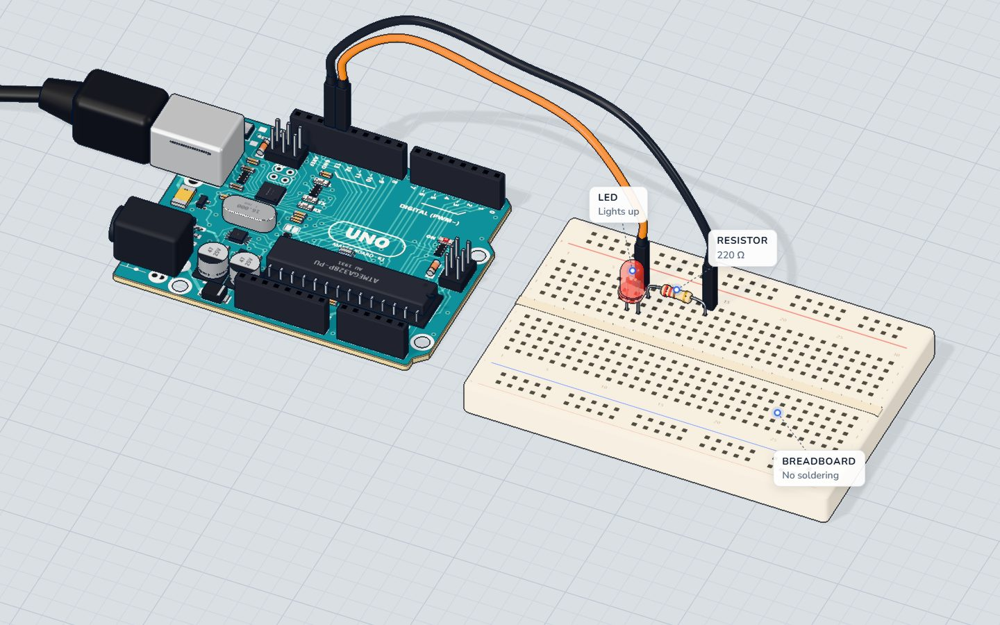

# Learn Arduino

**A free 3D Arduino lab in the browser: wire circuits, write real Arduino code, press Run, and watch it work.**
Live at **[learnarduino.tech](https://learnarduino.tech)**, with free step-by-step tutorials at [learnarduino.tech/learn](https://learnarduino.tech/learn/).



## What it does

- **Build circuits in 3D.** Put parts on a breadboard or straight on the table, and drag jumper wires between pins.
- **Write real Arduino code and press Run.** The sketch is compiled in the browser (GCC for AVR, compiled to WebAssembly) and runs on a simulated ATmega328P ([avr8js](https://github.com/wokwi/avr8js)).
- **See what happens electrically.** A small DC circuit solver lights LEDs, turns motors and moves servos, and shows the current flowing through the wires.
- **Make mistakes safely.** Forget the resistor and the LED burns; short 5 V to GND and the board burns, with sparks.
- **Read the real schematic.** Every circuit is also drawn as a schematic with standard symbols.
- **16 ready projects and 19 parts**, from Blink to an ultrasonic parking sensor and an OLED plant monitor, each with a written tutorial.
- Works on phones, and the 3D lab has no ads and no trackers.

## Run it on your computer

You need Node.js 20 or newer.

```sh
npm install
npm run dev        # the lab at http://localhost:5180, the tutorials at /learn/
```

| Command | What it does |
|---|---|
| `npm test` | Unit tests (Vitest) |
| `npm run e2e` | Browser tests (Playwright; phone and desktop) |
| `npm run build` | The site in `dist/`: the app plus the tutorial pages |
| `npm run learn:build` | Only the tutorial pages (from `content/learn/*.md`) |

## How it is built

| Folder | What is in it |
|---|---|
| `src/three/` | The 3D scene: React Three Fiber and three.js, every model built in code |
| `src/circuit/` | Nets, the circuit solver, burn rules, wiring checks, the schematic layout |
| `src/sim/` | The AVR simulator in a web worker, and the devices it drives (servo, stepper, OLED, buzzer…) |
| `src/build/` | Compiling sketches in the browser |
| `public/avr/` | The compiler (GCC 7.3 and binutils as WebAssembly) and the precompiled Arduino core, with their licences and sources |
| `content/learn/` | The tutorials, in Markdown, and their pictures |
| `tools/` | Builders: tutorial pages, pictures, the compiler, the core |

## Licences

This project uses different licences for different parts:

| What | Licence |
|---|---|
| The code (everything not listed below) | [GNU AGPL 3.0](LICENSE) |
| The UNO board layout data (`src/three/boards/uno/uno-layout.json`), from Arduino's UNO Rev3 design files | [CC BY-SA 4.0](LICENSES/CC-BY-SA-4.0.txt) |
| Pictures and renders (`content/learn/img/`, `src/assets/`) | [CC BY-SA 4.0](LICENSES/CC-BY-SA-4.0.txt) |
| Tutorial text (`content/learn/*.md`) | [CC BY-NC-SA 4.0](LICENSES/CC-BY-NC-SA-4.0.txt) |
| Example sketches (the code in the tutorials and in `src/content/projects/`) | [CC0 1.0](LICENSES/CC0-1.0.txt): free to use in your own sketches |
| The compiler and the Arduino core in `public/avr/` | Their own licences (GPL 3, LGPL 2.1/3, BSD), in the `LICENSES` folders there, with `SOURCES.md` |

Board layout based on Arduino UNO Rev3 design files (CC BY-SA 4.0).

### The name and the logo

The licences above cover the code and the content, not the name **Learn Arduino**, the learnarduino.tech domain, or the logo.
If you run your own copy, please give it a different name and logo, so nobody confuses it with this site.

**Learn Arduino is an independent project. It is not affiliated with, endorsed by or sponsored by Arduino S.r.l.**
"Arduino" and "UNO" are trademarks of Arduino S.r.l., used here only to say which board the lab simulates.

## Contributing

Issues and pull requests are welcome: bug reports, new parts, new projects and tutorial fixes.
Please run `npm test` before opening a pull request. By contributing, you agree that your work is shared under the licence
of the part you change (see the table above).
