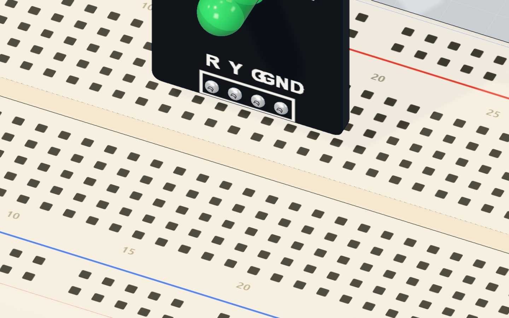
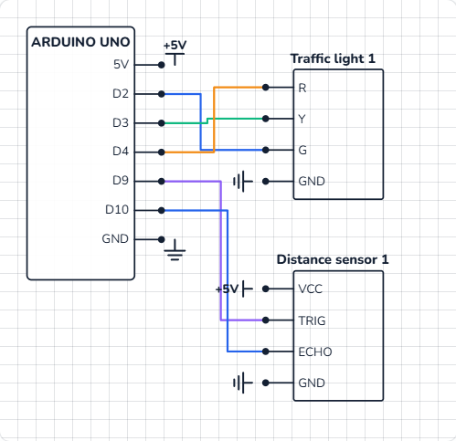

# Parking sensor

## What you will build

An HC-SR04 ultrasonic sensor watches the space in front of it about ten times a second. A traffic-light module shows how much room is left:

- **green** — more than 30 cm: plenty of room,
- **yellow** — 16 to 30 cm: slow down,
- **red** — 15 cm or less: **STOP**.

The Serial Monitor prints the distance too. Real cars do the same with four to eight ultrasonic sensors in the bumper, and robot vacuums use it to slow down before they touch a wall.

## How it works

This project puts together two things you already know. If you have built [Measure distance](/learn/measure-distance-hc-sr04/), the sensor part is the very same code.

### 1. Measure the distance

The Arduino sends a **10 µs pulse** to TRIG. The sensor sends out a burst of 40 kHz ultrasound and holds ECHO HIGH until the echo comes back. Sound needs about **58 µs to go 1 cm and back**, so the echo time divided by 58 is the distance in centimetres.

| Distance | Echo time | Light |
|---|---|---|
| 50 cm (the lab's start) | ≈ 2900 µs | Green |
| 31 cm | ≈ 1800 µs | Green |
| 30 cm | ≈ 1740 µs | Yellow |
| 16 cm | ≈ 930 µs | Yellow |
| 15 cm | ≈ 870 µs | **Red** |

### 2. Choose a light

Three **comparisons** decide which light is on. Each one is either true or false, and they are written so that **exactly one** is true for any distance:

| Light | Is on when | In code |
|---|---|---|
| Green | more than 30 cm | `cm > 30` |
| Yellow | more than 15 **and** up to 30 cm | `cm > 15 && cm <= 30` |
| Red | 15 cm or less | `cm <= 15` |

`&&` means **and**: both sides must be true.



### The traffic-light module

The module holds a red, a yellow and a green LED, and each already has its own **220 Ω resistor** on the board — so you wire it straight to the pins. Each LED takes about 13–14 mA:

| LED | Forward voltage | Current: (5 V − V) ÷ 220 Ω |
|---|---|---|
| Red | ≈ 1.9 V | ≈ 14 mA |
| Yellow | ≈ 2.0 V | ≈ 14 mA |
| Green | ≈ 2.1 V | ≈ 13 mA |

## The wiring

**The distance sensor** (standing on the table, facing the open space):

1. **VCC → 5V**, **TRIG → pin 9**, **ECHO → pin 10**, **GND → GND**.

**The traffic light** (on the breadboard):

2. Push the module's four pins into row c: **R in 15c, Y in 16c, G in 17c, GND in 18c**.
3. Wires: **pin 4 → 15a** (red), **pin 3 → 16a** (yellow), **pin 2 → 17a** (green), **18a → GND**.

| Part pin | Goes to | What it does |
|---|---|---|
| HC-SR04 VCC | 5V | Powers the sensor |
| HC-SR04 TRIG | Pin 9 | Starts a measurement |
| HC-SR04 ECHO | Pin 10 | Reports the echo time |
| HC-SR04 GND | GND | Return path |
| Traffic R | Pin 4 | Red light |
| Traffic Y | Pin 3 | Yellow light |
| Traffic G | Pin 2 | Green light |
| Traffic GND | GND | Shared return for all three LEDs |



> **Tip:** Keep the sensor's "eyes" pointing at open space, not at the breadboard or your wires — anything in front of it is an obstacle.

## The code, line by line

```cpp
const int TRIG = 9, ECHO = 10;
const int RED = 4, YELLOW = 3, GREEN = 2;

long distanceCm() {
  digitalWrite(TRIG, HIGH);
  delayMicroseconds(10);
  digitalWrite(TRIG, LOW);
  return pulseIn(ECHO, HIGH) / 58;
}

void setup() {
  pinMode(TRIG, OUTPUT);
  pinMode(ECHO, INPUT);
  pinMode(RED, OUTPUT);
  pinMode(YELLOW, OUTPUT);
  pinMode(GREEN, OUTPUT);
  Serial.begin(9600);
}

void loop() {
  long cm = distanceCm();
  digitalWrite(GREEN, cm > 30);
  digitalWrite(YELLOW, cm > 15 && cm <= 30);
  digitalWrite(RED, cm <= 15);
  Serial.print(cm);
  Serial.println(" cm");
  delay(80);
}
```

- **`const int RED = 4, YELLOW = 3, GREEN = 2;`** — names for the pins, so the rest of the code reads like English.
- **`long distanceCm() { … }`** is your own **function**: a named block of code that does one job and gives back (`return`s) an answer — here, the distance as a `long`. `loop()` stays short and clear.
- **`pulseIn(ECHO, HIGH) / 58`** times the echo in microseconds and turns it into centimetres. Whole-number division drops the fraction, so 1790 µs gives 30 cm.
- **`digitalWrite(GREEN, cm > 30)`** — a neat trick. A comparison is `true` (1) or `false` (0), and `digitalWrite()` treats 1 as HIGH and 0 as LOW. So the light simply follows the comparison — no `if` needed.
- **`digitalWrite(YELLOW, cm > 15 && cm <= 30)`** — yellow is on only when **both** are true.
- **`delay(80)`** — a short rest between measurements so old echoes can fade.

## Common mistakes

- **Red stays on, and the readings say 0 cm.** No echo arrives, so `pulseIn()` gives up after one second and returns 0 — and 0 is "15 or less". Check the TRIG and ECHO wires, and that VCC has 5 V.
- **Two lights are on at once.** The comparisons overlap, for example `cm >= 30` for green and `cm <= 30` for yellow. Each distance must fit exactly one rule.
- **The wrong colour lights.** The R, Y and G wires are swapped. Pin 4 is red, 3 is yellow, 2 is green.
- **No light at all.** The module's GND pin is not connected. All three LEDs return through it.

## Try these challenges

1. Make yellow start at **40 cm** (change both 30s).
2. Add a buzzer that **beeps** on red — see [play a tune with a buzzer](/learn/play-a-tune-buzzer-arduino/).
3. Make the beeps get faster as the obstacle gets closer, like a real car: wait `cm * 10` ms between beeps.
4. In the 3D lab, **drag the obstacle** toward the sensor and watch the light change at 30 cm and 15 cm. Then type a distance in the sensor's window.

## Check yourself

::: quiz
? The sensor measures 30 cm. Which light is on?
- Green
- Yellow *
- Red
= Green needs more than 30 cm. 30 is more than 15 and not more than 30, so yellow is on.
? What does && mean in cm > 15 && cm <= 30?
- Or: one of the two is true
- And: both must be true *
- Not: the opposite
= && is "and". Yellow lights only when the distance is more than 15 cm and at most 30 cm.
? Why does the traffic-light module need no extra resistors?
- Each LED already has its own 220 Ω resistor on the board *
- Traffic-light LEDs cannot burn out
- The Arduino limits the current itself
= The module has a 220 Ω resistor for each LED, so each one gets about 13–14 mA.
:::

## Questions people ask

### How do I add a beeping buzzer to an Arduino parking sensor?
Put a passive buzzer between a free pin (for example pin 8) and GND, and call `tone(8, 1000, 50)` when `cm <= 15`. For beeps that speed up as you get closer, make the pause between them depend on the distance.

### Can I use separate LEDs instead of a traffic-light module?
Yes. Use three LEDs, each with its own 220 Ω resistor, from pins 2, 3 and 4 to GND — see [Blink an LED](/learn/blink-an-led/). The code does not change at all.

### Why does my parking sensor flicker between two colours?
Near a limit the reading wobbles by a centimetre. Add **hysteresis** — two limits, one for each direction — just like in [the thermostat project](/learn/arduino-thermostat-tmp36-fan/).

### How far can an Arduino parking sensor see?
The HC-SR04 measures from about 2 cm to 4 m, so it is fine for a garage. Soft or angled objects reflect less sound and may be missed.

## What's next

You have finished all sixteen projects — well done! 🎉 Pick your next challenge from [all the tutorials](/learn/), or open [the Build bench](/#/build) and invent your own circuit.
