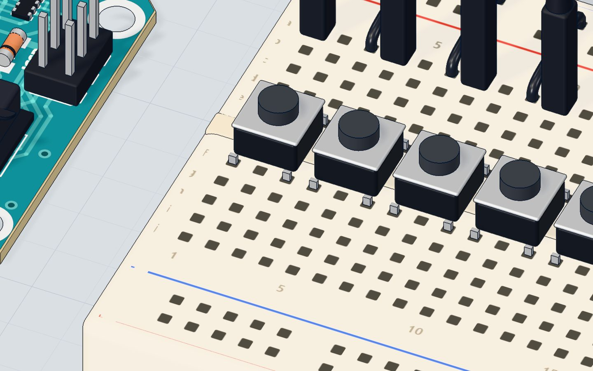
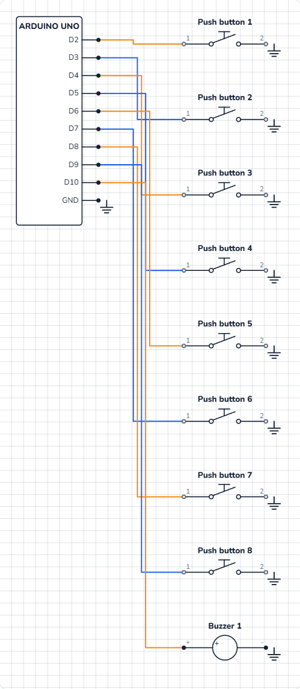

# Mini piano

## What you will build

A row of **eight buttons** that work like piano keys, and a buzzer. Press a key and its note plays for as long as you hold it; let go and it stops. The eight keys play one octave of the C major scale — **Do, Re, Mi, Fa, Sol, La, Ti, Do** — and the serial monitor prints the name of each note you play.

Musical keyboards, keypads on alarm panels and the buttons on arcade machines all do what this sketch does: **scan many inputs, find the one that is pressed, react**.

## How it works

In the [push button project](/learn/push-button-arduino/), each button needed a 10 kΩ pull-down resistor. Eight buttons would need eight resistors. The UNO has a shortcut built in: every pin has its own **pull-up resistor** inside the chip that you can switch on in code with **`INPUT_PULLUP`**.

- **Key not pressed:** the internal pull-up (about 20–50 kΩ; our lab uses 35 kΩ) holds the pin at **5 V**. It reads **HIGH**.
- **Key pressed:** the button joins the pin straight to **GND**. It reads **LOW**.

So the logic is "upside down": **pressed = LOW**. The current through the pull-up while you press is tiny: 5 V ÷ 35 kΩ ≈ **0.14 mA**. More in [pull-up and pull-down resistors](/learn/pull-up-pull-down-resistors/).

Each key has its own pin and its own note:

| Key | Pin | Note | Frequency |
|---|---|---|---|
| 1 | 2 | Do (C) | 262 Hz |
| 2 | 3 | Re (D) | 294 Hz |
| 3 | 4 | Mi (E) | 330 Hz |
| 4 | 5 | Fa (F) | 349 Hz |
| 5 | 6 | Sol (G) | 392 Hz |
| 6 | 7 | La (A) | 440 Hz |
| 7 | 8 | Ti (B) | 494 Hz |
| 8 | 9 | Do (high C) | 523 Hz |

The last Do is twice the first (262 × 2 ≈ 523): one octave higher.



## The wiring

The buttons sit across the breadboard's middle gap in a row, starting in columns **1, 4, 7, 10, 13, 16, 19 and 22**. Each button spans its own column and the column two to the right (so the first spans columns 1 and 3).

1. Push the eight buttons in across the gap, one at each of those columns.
2. Jumper wire from **GND → the top − rail** (at column 2). Now the whole rail is ground.
3. For each key: a wire from its **pin** to the top of its **first column** — pin 2 → 1a, pin 3 → 4a, pin 4 → 7a, pin 5 → 10a, pin 6 → 13a, pin 7 → 16a, pin 8 → 19a, pin 9 → 22a.
4. For each key: a short wire from the **− rail** down to the top of its **second column** — 3a, 6a, 9a, 12a, 15a, 18a, 21a, 24a.
5. Push the **buzzer** in with its **+** leg in **26b** and its other leg in **29b**.
6. Jumper wires: **pin 10 → 26a**, **29a → GND**.

| Part pin | Goes to | What it does |
|---|---|---|
| Each key, first column | Pins 2–9 | The pin that reads that key |
| Each key, second column | Top − rail → GND | Pressing pulls the pin LOW |
| Buzzer + | Pin 10 | Plays the note with tone() |
| Buzzer − | GND | The return path |



> **Tip:** No resistors on the keys — `INPUT_PULLUP` is doing that job inside the chip. If you forget it in the code, the keys float and the piano plays random notes.

## The code, line by line

```cpp
const int BUZZER = 10;
const int KEYS[] = { 2, 3, 4, 5, 6, 7, 8, 9 };
const int NOTES[] = { 262, 294, 330, 349, 392, 440, 494, 523 };   // C D E F G A B C
const char* NAMES[] = { "Do", "Re", "Mi", "Fa", "Sol", "La", "Ti", "Do" };
int playing = -1;

void setup() {
  for (int i = 0; i < 8; i++) pinMode(KEYS[i], INPUT_PULLUP);
  Serial.begin(9600);
}

void loop() {
  int down = -1;
  for (int i = 0; i < 8; i++) {
    if (digitalRead(KEYS[i]) == LOW) down = i;   // pressed keys read LOW
  }
  if (down != playing) {
    playing = down;
    if (playing < 0) noTone(BUZZER);
    else {
      tone(BUZZER, NOTES[playing]);
      Serial.println(NAMES[playing]);
    }
  }
}
```

- **Three arrays in step:** key *i* is on pin `KEYS[i]`, plays `NOTES[i]` and is called `NAMES[i]`. `const char*` is how C++ stores a list of words.
- **`int playing = -1;`** remembers which key is sounding. **−1** means "none" — a number that can never be a real key.
- **`for (…) pinMode(KEYS[i], INPUT_PULLUP);`** switches on the internal pull-up on all eight pins in one line.
- **The scan:** `down` starts at −1; the loop checks every key, and any key that reads **LOW** is pressed, so `down = i`. If two keys are held, the higher one wins, because it is checked last.
- **`if (down != playing)`** — only act when something *changes*, just like the button project. Otherwise `tone()` would restart thousands of times a second.
- **`noTone(BUZZER)`** stops the sound when no key is down.
- **`tone(BUZZER, NOTES[playing])`** — with no duration, the note plays until the next `tone()` or `noTone()`. That is why it lasts as long as you hold the key.

## Common mistakes

- **Notes play by themselves.** `INPUT_PULLUP` is missing (plain `INPUT`), so the pins float. Use `INPUT_PULLUP`.
- **A key plays all the time.** That button is not across the gap, or both its wires are on the same side of it. The pin and the rail must go to *different* columns of the button.
- **No key works.** The − rail is not wired to GND. One wire from GND to the rail is all it takes.
- **Notes are in the wrong order.** A key wire is on the wrong pin. Pin 2 is Do; count up from there.
- **The note never stops.** The `noTone()` line is missing or `playing` is never reset to −1.

## Try these challenges

1. Shift every note up an octave: double the numbers in `NOTES[]`.
2. Make the lowest key win instead of the highest (hint: stop the scan with `break;` at the first pressed key).
3. Light the board's L LED on pin 13 while any key is down.
4. In the 3D lab, turn sound on in the toolbar and press the keys in 3D. Can you play "Ode to Joy" from the [tune project](/learn/play-a-tune-buzzer-arduino/)? It starts Mi Mi Fa Sol.

## Check yourself

::: quiz
? With INPUT_PULLUP, what does a pressed button read?
- HIGH
- LOW *
- 1023
= The pull-up holds the pin HIGH; pressing joins it to GND, so it reads LOW.
? Why does this circuit need no resistors on the buttons?
- The buttons have resistors inside
- The UNO's own pull-up resistors are switched on with INPUT_PULLUP *
- The buzzer limits the current
= Each pin has a pull-up of about 20–50 kΩ inside the chip.
? What does playing = -1 mean in this sketch?
- The highest key
- The volume is off
- No key is being played *
= −1 cannot be a real key number (0–7), so it safely means "none".
:::

## Questions people ask

### What is INPUT_PULLUP on Arduino?
It is a pin mode that turns on a resistor inside the chip, connecting the pin to 5 V. The pin then reads HIGH when nothing is connected and LOW when a button joins it to GND — no external resistor needed.

### How many buttons can an Arduino UNO read?
One per pin: up to 18 if you use D2–D13 and A0–A5 as digital inputs (keep D0 and D1 free for the serial monitor). For more, use a button matrix or a shift register.

### Can the Arduino piano play two notes at once?
Not with one buzzer and `tone()`: it plays one frequency at a time. In this sketch the highest pressed key wins.

### Why is the logic inverted with a pull-up?
Because the resistor holds the pin HIGH when idle, and the button pulls it LOW. Just remember: with `INPUT_PULLUP`, **LOW means pressed**.

## What's next

You have mastered inputs and sound. Next, make something **move**: drive a DC motor with a transistor in the [motor project](/learn/dc-motor-transistor-arduino/).
