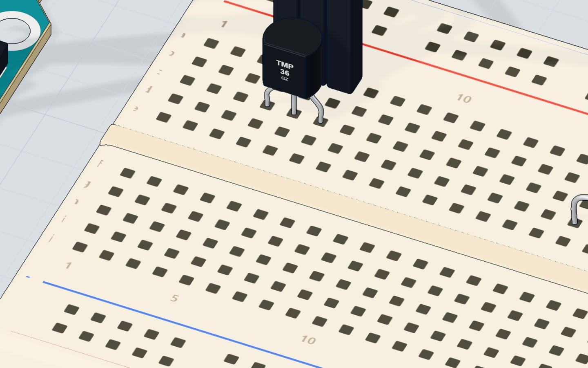
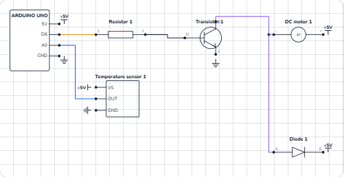

# Thermostat

## What you will build

A fan that switches **on above 30 °C** and **off again below 28 °C**, with no button to press. The Arduino reads a TMP36 temperature sensor three times a second, prints the temperature to the Serial Monitor, and decides what the fan should do.

That is exactly what the thermostat on a wall heater, a fridge, a 3D printer or a computer's cooling fan does: **measure, compare, act**. Swap the fan for a heater (through a relay) and you have a heating controller.

## How it works

### The TMP36: a voltage that follows the temperature

The **TMP36** is a tiny chip with three legs that gives out a voltage that rises with the temperature. Its rule is simple:

**volts = 0.5 V + 0.01 V × °C**

So it gives 0.5 V at 0 °C, and **10 mV more for every degree**. Because of the 0.5 V start it can show temperatures below zero too, down to −40 °C.

| Temperature | TMP36 output | `analogRead()` gives |
|---|---|---|
| 0 °C | 0.50 V | ≈ 102 |
| 24 °C (the lab's start) | 0.74 V | ≈ 151 |
| 28 °C (fan off below) | 0.78 V | ≈ 160 |
| 30 °C (fan on above) | 0.80 V | ≈ 164 |
| 40 °C | 0.90 V | ≈ 184 |

`analogRead()` turns 0–5 V into a number from 0 to 1023, so one step is 5 ÷ 1023 ≈ **4.9 mV — about half a degree**. That is the finest change this circuit can see.



### Hysteresis: two limits instead of one

Why two limits, 30 °C and 28 °C? Imagine a single limit at 30 °C. The room sits at 30.0 °C, the reading wobbles by half a degree, and the fan clicks on, off, on, off, many times a minute. That wears out motors and drives people mad.

With a **gap** between the two limits — called **hysteresis** — the fan turns on above 30 °C, and then stays on until the room has really cooled below 28 °C. Every heater and air conditioner works this way.

### The fan driver

The fan is the motor from [the DC motor project](/learn/dc-motor-transistor-arduino/), wired exactly the same: pin 6 through a **1 kΩ** resistor into a **TIP120** transistor, the motor between 5 V and the collector, and a **1N4001** flyback diode across the motor. The pin gives about 3.6 mA; the transistor switches up to about 0.5 A for the motor.

## The wiring

**The sensor:**

1. Push the **TMP36** into row c with its flat face toward you: **+Vs in 4c, OUT in 5c, GND in 6c**.
2. A wire from **5V** to **4a**.
3. A wire from **5a** to **A0**.
4. A wire from **6a** to **GND**.

**The fan driver** (the same as the motor project):

5. **TIP120** in row c: base **20c**, collector **21c**, emitter **22c**, label toward you.
6. **1 kΩ resistor** from **16d** to **20d**, and **1N4001 diode** from **21e** (anode) to **25e** (band).
7. Wires: **pin 6 → 16a**, **5V → motor +**, **motor − → 21a**, **22a → GND**, **5V → 25a**.

| Part pin | Goes to | What it does |
|---|---|---|
| TMP36 +Vs | 5V | Powers the sensor (it needs at least 2.7 V) |
| TMP36 OUT | A0 | The temperature, as a voltage |
| TMP36 GND | GND | Return path |
| 1 kΩ → TIP120 base | Pin 6 | The Arduino switches the fan |
| Motor + / − | 5V / collector | The fan's power, switched by the transistor |
| TIP120 emitter | GND | The fan's current goes back to ground |
| 1N4001 diode | Across the motor, band to 5V | Catches the spike when the fan stops |



> **Warning:** The TMP36 looks just like a common transistor. Put it in backwards (5 V on the GND leg) and it gets hot fast. Flat face toward you, 5 V on the left.

## The code, line by line

```cpp
const int SENSOR = A0;
const int FAN = 6;
bool fanOn = false;

void setup() {
  pinMode(FAN, OUTPUT);
  Serial.begin(9600);
}

void loop() {
  float volts = analogRead(SENSOR) * 5.0 / 1023.0;
  float celsius = (volts - 0.5) * 100.0;
  if (celsius > 30) fanOn = true;
  if (celsius < 28) fanOn = false;
  analogWrite(FAN, fanOn ? 220 : 0);
  Serial.print(celsius, 1);
  Serial.println(fanOn ? " C  fan ON" : " C  fan off");
  delay(300);
}
```

- **`bool fanOn = false;`** — a `bool` holds only `true` or `false`. It is the thermostat's memory: is the fan on right now? It lives outside `loop()` so it keeps its value between rounds.
- **`analogRead(SENSOR) * 5.0 / 1023.0`** turns the 0–1023 reading back into volts. Writing `5.0` (not `5`) makes it a **float** — a number with decimals — so nothing is rounded away.
- **`(volts - 0.5) * 100.0`** undoes the TMP36's rule: take away the 0.5 V start, then 10 mV per degree means multiply by 100.
- **`if (celsius > 30) fanOn = true;`** and **`if (celsius < 28) fanOn = false;`** — the hysteresis. Between 28 and 30 °C neither line runs, so the fan keeps doing whatever it was doing.
- **`fanOn ? 220 : 0`** is a short *if*: "if `fanOn`, use 220, else 0". 220 out of 255 runs the fan at about 86 % power.
- **`Serial.print(celsius, 1)`** prints the temperature with **one** decimal place.

## Common mistakes

- **It reads −50 °C.** A0 sees 0 V, and (0 − 0.5) × 100 = −50. The A0 wire is on the GND leg, or the sensor has no power. Flat face toward you: 5V, OUT, GND.
- **The temperature jumps by half a degree.** That is one step of `analogRead()` (4.9 mV). Average a few readings for a steadier number.
- **The fan clicks on and off.** You used one limit for both on and off. Keep a gap of at least a degree or two.
- **The fan never starts.** Check the driver like in the motor project: the emitter must go to GND, the motor's − to the collector.
- **Integer maths.** `analogRead(SENSOR) * 5 / 1023` with whole numbers rounds everything down to 0 or 1 volt. Use `5.0` and `1023.0`.

## Try these challenges

1. Change the limits to **25 °C and 23 °C**.
2. Print the temperature in **Fahrenheit** too: `celsius * 9.0 / 5.0 + 32`.
3. Make the fan **faster the hotter it gets**: 150 at 30 °C, up to 255 at 35 °C (try `map()`).
4. In the 3D lab, drag the **hairdryer** close to the sensor and watch the number climb; then type a temperature in the sensor's window.

## Check yourself

::: quiz
? The TMP36 gives 0.75 V. What is the temperature?
- 75 °C
- 25 °C *
- 7.5 °C
= Take away 0.5 V to get 0.25 V, then multiply by 100: 25 °C.
? Why does the thermostat use two limits, 30 °C and 28 °C?
- So the fan does not flick on and off when the temperature sits near one limit *
- Because the TMP36 has two outputs
- To make the fan spin faster
= This gap is called hysteresis. The fan turns on above 30 °C and stays on until it is below 28 °C.
? Why does the code write 5.0 instead of 5?
- 5.0 volts is more exact than 5 volts
- To make it a float, so the maths keeps its decimals *
- The Arduino cannot read the number 5
= With only whole numbers the division would round down. A decimal point makes it floating-point maths.
:::

## Questions people ask

### How accurate is the TMP36?
About ±2 °C out of the box, and the Arduino's analog input adds about half a degree of steps. That is fine for a fan; for weather stations use a digital sensor like the DS18B20 or the BME280.

### What is the formula to convert TMP36 voltage to Celsius?
°C = (volts − 0.5) × 100. In Arduino code: `float celsius = (analogRead(A0) * 5.0 / 1023.0 - 0.5) * 100.0;`. See [the TMP36 explained](/learn/tmp36-temperature-sensor-explained/) for more.

### Can I switch a real heater or air conditioner this way?
Not with a transistor on 5 V. Mains devices need a **relay module** (or a solid-state relay) controlled by the pin — and mains wiring should be done only by someone qualified.

### Why does my TMP36 get hot?
It is in backwards. The TMP36 draws only microamps when wired correctly, so if it is warm to the touch, unplug at once and turn it around.

## What's next

You have switched a motor on and off. Now point a motor at an exact angle: [sweep a servo motor](/learn/servo-motor-arduino/).
