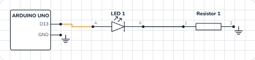

# Blink an LED

## What you will build

A red LED that switches on for one second, off for one second, forever. It sounds tiny — but it is the same thing every Arduino project does: **a program decides when a pin is on or off, and a circuit turns that into something you can see**. Once you understand this one, motors, buzzers and robots are the same idea with different parts.

## How it works, in one picture

An Arduino pin is like a tiny switch that the program flips between **5 V** (HIGH) and **0 V** (LOW).

- When pin 13 is **HIGH**, current flows out of the pin, through the LED, through the resistor, and back into **GND**. The LED lights.
- When pin 13 is **LOW**, both ends of the circuit are at 0 V. No current flows, so the LED goes dark.

Current always needs a complete loop: out of the pin, through the parts, and back to GND. Break the loop anywhere and nothing happens.

 goes toward pin 13; the resistor leads on to GND.")

## Why the LED needs a resistor

An LED has almost no resistance once it starts to glow. Wired straight to 5 V it would try to pull far more current than it can take — and burn out (in our 3D lab it really does, with a puff of smoke 💨).

The **220 Ω resistor** limits the current. With a red LED (about 1.9 V across it), the resistor gets the rest:

| | Value |
|---|---|
| Pin voltage | 5 V |
| LED voltage (red) | ≈ 1.9 V |
| Left for the resistor | 5 − 1.9 = 3.1 V |
| Current (Ohm's law, I = V ÷ R) | 3.1 V ÷ 220 Ω ≈ **14 mA** |

14 mA is bright, safe for the LED (max about 20 mA) and safe for the pin (max 40 mA).

> **Tip:** A bigger resistor (1 kΩ) makes the LED dimmer; a smaller one makes it brighter. Never go to 0 Ω.

## The wiring

1. Push the LED into the breadboard. The **long leg is the anode (+)**, the short leg the cathode (−).
2. Put the 220 Ω resistor so that one of its legs is in the same row of five holes as the LED's short leg.
3. A jumper wire from **pin 13** to the LED's long leg.
4. A jumper wire from the resistor's free leg to **GND**.

Here is the same circuit as a schematic, the way electronics engineers draw it. Pins with the same label are connected:



> **Did you know?** Pin 13 also has a tiny LED on the board itself, marked **L**. That is why Blink works even with nothing plugged in.

## The code, line by line

```cpp
void setup() {
  pinMode(13, OUTPUT);
  Serial.begin(9600);
}

void loop() {
  digitalWrite(13, HIGH);
  Serial.println("LED on");
  delay(1000);
  digitalWrite(13, LOW);
  Serial.println("LED off");
  delay(1000);
}
```

- **`setup()`** runs once, when the board powers up or resets.
- **`pinMode(13, OUTPUT)`** makes pin 13 an output: the program drives it, instead of reading it.
- **`Serial.begin(9600)`** opens the serial connection so the board can print messages to your computer (the Serial Monitor) at 9600 bits per second.
- **`loop()`** runs again and again, forever.
- **`digitalWrite(13, HIGH)`** puts 5 V on the pin — the LED turns on.
- **`delay(1000)`** waits 1000 milliseconds = 1 second. The board does nothing else meanwhile.
- **`digitalWrite(13, LOW)`** puts 0 V on the pin — the LED turns off.

## Common mistakes

- **The LED is in backwards.** It only conducts one way. Flip it: long leg toward the pin.
- **No resistor.** The LED is bright for a moment, then dead. Always add one.
- **Both LED legs in the same row.** The five holes of a row are joined inside the breadboard, so the LED is short-circuited and never lights. See [how a breadboard works](/learn/what-is-a-breadboard/).
- **Wire to the wrong pin.** The code says 13 — the wire must go to 13.

## Try these challenges

1. Make it blink twice as fast (change both delays to `500`).
2. Make a heartbeat: on 100 ms, off 100 ms, on 100 ms, off 700 ms.
3. Move the LED to pin 12 — change the wire **and** the code.
4. In the 3D lab, delete the resistor and put a jumper wire in its place (from the LED's short-leg row to GND). Press Run and watch what happens — then press *Replace part*.

## Check yourself

::: quiz
? Which leg of the LED goes toward pin 13?
- The long leg (anode, +) *
- The short leg (cathode, −)
- It does not matter
= An LED only conducts one way: current goes in at the long leg (anode) and out at the short leg (cathode).
? What does delay(1000) do?
- Waits one second *
- Makes the LED 1000 times brighter
- Sets pin 13 to 1000
= delay() pauses the program for that many milliseconds — 1000 ms is one second.
? Why is the 220 Ω resistor there?
- It limits the current so the LED and the pin are safe *
- It makes the LED blink
- It stores energy for the LED
= Without it the LED would try to pull far more current than it can take, and burn out.
:::

## Questions people ask

### Can I use any pin, not just 13?
Yes — pins 2 to 13 all work as outputs. Change the number in `pinMode` and `digitalWrite` to match.

### Why 220 Ω? Can I use 330 Ω or 1 kΩ?
Anything from about 150 Ω to 1 kΩ works. Bigger is dimmer and gentler; 220 Ω or 330 Ω is the usual choice.

### Do I need an Arduino to try this?
No. Every project here runs in our free [3D lab](/) in your browser — the code really compiles and runs on a simulated ATmega328P, the same chip as on the UNO.

## What's next

You now know how to **control** something. Next, learn how to **read** something: [a push button](/learn/push-button-arduino/) — your first input.
