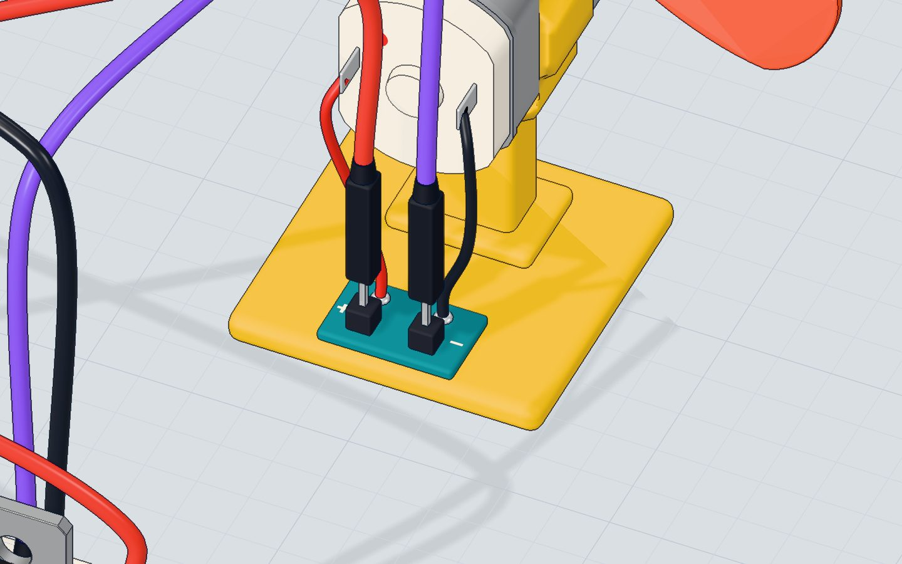
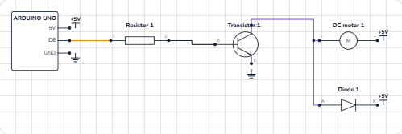

# Control a DC motor

## What you will build

A small fan that speeds up step by step from stopped to full speed, runs for a moment, then stops — and does it again. The Serial Monitor prints every speed as it goes. The Arduino does not power the motor itself: it gives a tiny signal to a **transistor**, and the transistor switches the big current.

This is how almost every Arduino robot, drone and fan works. A pin decides, a transistor (or a motor driver chip full of transistors) does the heavy lifting.

## How it works

### Why a pin cannot drive a motor

A small hobby motor's coil has a resistance of only about **8 Ω**. An Arduino pin is safe up to about **20 mA**, and it is damaged above **40 mA**. Let us do the math:

| | Value |
|---|---|
| Motor on 5 V, straight from a supply | 5 V ÷ 8 Ω ≈ **625 mA** |
| What a pin is safe to give | about **20 mA** |
| What damages a pin | **40 mA** |
| What the motor needs at full speed in our lab | about **500 mA** |

The motor wants **25 times** more current than the pin can safely give. Wire it straight to pin 6 and the pin is asked for around 150 mA (its own resistance holds it back a little) — nearly four times the limit. In our 3D lab the pin burns. 🔥

### The transistor: a small current switches a big one

The **TIP120** is an NPN *Darlington* transistor — two transistors in one package, so it has a huge gain (it multiplies the base current by 1000 or more). It has three legs:

- **B (base)** — the control input. A few milliamps in here…
- **C (collector)** — …let a big current flow in here, from the motor…
- **E (emitter)** — …and out here, to GND.

The base needs about **1.4 V** to turn on, so pin 6 feeds it through a **1 kΩ resistor**:

| | Value |
|---|---|
| Pin voltage when HIGH | 5 V |
| Base–emitter voltage (TIP120) | ≈ 1.4 V |
| Left for the resistor | 5 − 1.4 = 3.6 V |
| Base current (I = V ÷ R) | 3.6 V ÷ 1000 Ω ≈ **3.6 mA** |
| Motor current it switches | 5 V ÷ (8 Ω motor + about 2 Ω in the transistor) ≈ **0.5 A** |

3.6 mA in, 500 mA out — and the pin stays cool.

### The diode: catching the spike

A motor is a coil of wire, and a coil hates sudden changes in current. When the transistor switches off, the coil tries to keep the current flowing and pushes the voltage at its minus end far up — easily **dozens of volts** for an instant. That spike can damage the transistor.

The **1N4001 diode** sits across the motor, pointing "backwards" (its band toward 5 V). In normal running it carries nothing. The moment the transistor turns off, the spike makes the diode conduct, and the current just goes round and round through the motor and diode until it fades. The voltage can rise only about **0.7 V** above 5 V. That is why it is called a **flyback diode**.



### PWM: setting the speed

`analogWrite(6, speed)` does not give a lower voltage. It switches the pin fully on and off about **980 times a second** (pin 6's PWM rate), and `speed` (0–255) sets how much of each cycle is ON. At 128 the motor gets power half the time, so it spins at about half speed. Read more in [PWM explained](/learn/pwm-explained-analogwrite/).

## The wiring

1. Push the **TIP120** into row c with its label facing you: **base in 20c, collector in 21c, emitter in 22c**.
2. Put the **1 kΩ resistor** from **16d** to **20d** — its right leg shares a row with the base.
3. Put the **1N4001 diode** from **21e** (anode, plain end) to **25e** (cathode, the end with the band).
4. A wire from **pin 6** to **16a** (the resistor).
5. The motor's **+** to **5V**, and the motor's **−** to **21a** (the collector).
6. A wire from **22a** (the emitter) to **GND**.
7. A wire from **5V** to **25a** (the diode's band end).

| Part pin | Goes to | What it does |
|---|---|---|
| 1 kΩ resistor | Pin 6 → base (20) | Limits the base current to ≈ 3.6 mA |
| TIP120 base (B) | Resistor | Turns the transistor on |
| TIP120 collector (C) | Motor − (21) | The motor's current flows in here |
| TIP120 emitter (E) | GND (22) | …and out to ground |
| Motor + | 5V | Power for the motor |
| Diode anode (A) | Collector / motor − (21) | Catches the spike… |
| Diode cathode (K, band) | 5V (25) | …and sends it back round the motor |



> **Warning:** The motor runs from the UNO's 5V pin, which comes from your USB port. Half an amp is about the most USB gives. For bigger motors use a separate battery or supply for the motor, and join its minus to the Arduino's GND.

## The code, line by line

```cpp
const int MOTOR = 6;   // a ~ pin, through the transistor

void setup() {
  pinMode(MOTOR, OUTPUT);
  Serial.begin(9600);
}

void loop() {
  for (int speed = 0; speed <= 255; speed += 15) {
    analogWrite(MOTOR, speed);
    Serial.print("speed ");
    Serial.println(speed);
    delay(150);
  }
  delay(1500);
  analogWrite(MOTOR, 0);
  Serial.println("stop");
  delay(1500);
}
```

- **`const int MOTOR = 6;`** — pin 6 has a **~** next to it on the board, which means it can do PWM. Only pins 3, 5, 6, 9, 10 and 11 can.
- **`pinMode(MOTOR, OUTPUT)`** — the pin drives the transistor's base.
- **`for (int speed = 0; speed <= 255; speed += 15)`** counts 0, 15, 30 … 255 — eighteen steps.
- **`analogWrite(MOTOR, speed)`** sets the PWM duty: 0 is off, 255 is always on.
- **`delay(150)`** holds each speed for 150 ms, so the whole ramp takes about 2.7 seconds.
- **`delay(1500)`** then runs at full speed for 1.5 s, **`analogWrite(MOTOR, 0)`** stops it, and it rests 1.5 s.

## Common mistakes

- **The motor does not spin.** The TIP120's legs are in the wrong holes. With the label facing you they are B, C, E from left to right.
- **Nothing happens at all.** The emitter is not on GND, or the motor's − goes to the wrong leg. Current must flow 5V → motor → collector → emitter → GND.
- **The motor wired straight to pin 6.** The pin is asked for far more than 40 mA and dies. Always go through the transistor.
- **The diode is the wrong way round.** With the band toward the collector, the moment the transistor turns on it makes a short from 5 V through the diode and transistor to GND. The band goes to **5V**.
- **It hums at low speeds but does not turn.** Normal: a motor needs a push to start. Begin from about 60 instead of 0.

## Try these challenges

1. Make it hold **half speed** forever: `analogWrite(MOTOR, 128);` in `setup()`, and an empty `loop()`.
2. Make it slow down again, step by step, instead of stopping at once.
3. Add a potentiometer on A0 and set the speed with `analogRead(A0) / 4` — see [the potentiometer project](/learn/potentiometer-arduino/).
4. In the 3D lab, move the motor's − wire from the collector straight to **pin 6** and press Run. Read what the board says, then put it back.

## Check yourself

::: quiz
? Why can't you connect a motor straight to an Arduino pin?
- The motor needs hundreds of milliamps; a pin is safe only to about 20 mA *
- The motor needs more than 5 V
- Pins can only drive LEDs
= A small motor wants about 500 mA. A pin is safe to about 20 mA and is damaged above 40 mA, so a transistor switches the big current.
? What does the 1N4001 diode across the motor do?
- It makes the motor spin faster
- It catches the voltage spike when the motor is switched off *
- It turns the motor the other way
= When the current stops, the motor's coil makes a spike. The diode gives it a safe path, so the voltage can rise only about 0.7 V above 5 V.
? What does analogWrite(6, 128) do?
- Puts 2.5 V on pin 6 all the time
- Switches pin 6 on and off very fast, on about half the time *
- Sets the motor to 128 turns a minute
= analogWrite() is PWM: the pin is fully on or fully off, and 128 out of 255 means on about half the time.
:::

## Questions people ask

### Can I use a different transistor instead of the TIP120?
Yes. A logic-level MOSFET (like the IRLZ44N) works even better, because it wastes less power. A small transistor like the 2N2222 is fine for motors of a few hundred milliamps. For motors that must turn both ways, use a motor driver chip such as the L298N or TB6612.

### Why does a motor need a flyback diode?
A motor is a coil. When its current is switched off suddenly, the coil makes a voltage spike that can reach dozens of volts and damage the transistor. The diode across the motor gives that current a safe loop to fade away. See [what a diode is](/learn/what-is-a-diode/).

### How do I make the motor spin the other way?
Swap its two wires. To change direction from code you need an **H-bridge** — four switches that can turn the motor's wires around — which is what an L298N or L293D chip contains.
## What's next

Now let the Arduino decide **when** to switch the fan on: build [a thermostat with a TMP36 temperature sensor](/learn/arduino-thermostat-tmp36-fan/) that uses this exact motor driver.
