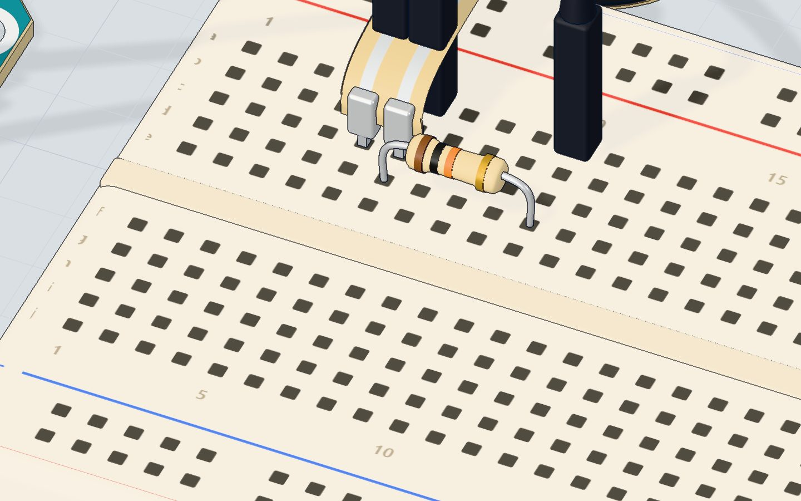
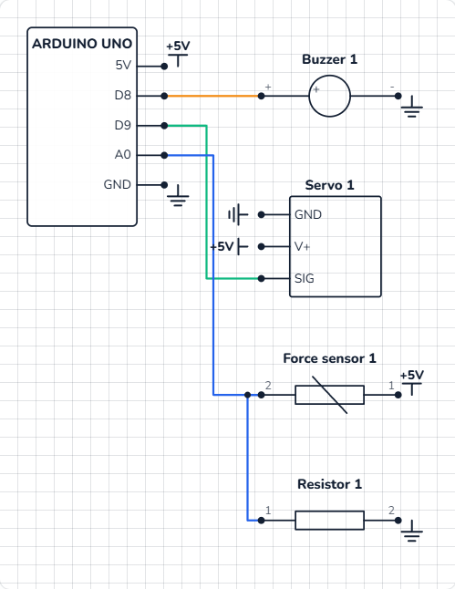

# Strength tester

## What you will build

A **force-sensing resistor** (FSR) — a thin round pad — measures how hard you press. A servo swings a needle to show it, like the dial on a fairground "high striker". The needle **holds your best press for 1.5 seconds** so everyone can see it, and if you press hard enough a buzzer rings a high **bell note**. The Serial Monitor prints every reading.

FSRs are in drum pads that play louder when you hit harder, in robot grippers that must not crush an egg, in seats that know someone is sitting, and in many game controllers.

## How it works

### The FSR: a resistor you can squeeze

An FSR is two thin layers with a special ink between them. Press harder and more of the ink touches, so the **resistance falls**:

- not pressed: about **10 MΩ** (practically open),
- 100 g: about **10 kΩ**,
- 1 kg: about **1 kΩ**.

### A voltage divider turns force into volts

An Arduino cannot measure resistance directly — it measures **voltage**. So the FSR is paired with a fixed **10 kΩ resistor** to make a **voltage divider**: the FSR goes from 5 V to A0, the resistor from A0 to GND. The voltage at A0 is:

**V = 5 V × 10 kΩ ÷ (10 kΩ + FSR resistance)**

The lower the FSR's resistance, the bigger its share of the 5 V that reaches A0:

| Press | FSR resistance | Voltage at A0 | `analogRead()` | Needle |
|---|---|---|---|---|
| Nothing | ≈ 10 MΩ | ≈ 0 V | ≈ 1 | 0° |
| 100 g | 10 kΩ | 2.50 V | ≈ 511 | 89° |
| 200 g | 5 kΩ | 3.33 V | ≈ 682 | 120° |
| 500 g | 2 kΩ | 4.17 V | ≈ 852 | 149° |
| ≈ 615 g — **the bell** | ≈ 1.6 kΩ | 4.30 V | **880** | 154° |
| 1 kg | 1 kΩ | 4.55 V | ≈ 930 | 163° |

Notice the curve: the first 100 g moves the needle halfway; after that you need more and more force for each degree. That is what makes the top hard to reach — just like at the fair. Learn more in [the FSR explained](/learn/force-sensing-resistor-explained/).



### Holding the best score with millis()

`delay()` stops everything. Here the Arduino must keep reading the pad **and** remember when the best score was set. **`millis()`** gives the number of milliseconds since the board started, without stopping anything. The sketch saves the time of the best press, and when more than 1500 ms have passed, it lets the needle fall back to the current reading.

## The wiring

**The force sensor and its resistor:**

1. Push the **FSR's** two legs into **5c** and **6c**.
2. Put the **10 kΩ resistor** from **6d** to **10d** — it shares column 6 with the FSR.
3. A wire from **5V** to **5a**, a wire from **6a** to **A0**, and a wire from **10a** to **GND**.

**The bell (buzzer):**

4. Push the **buzzer** in with its **+** leg in **20b** and its **−** leg in **23b**.
5. A wire from **pin 8** to **20a**, and from **23a** to **GND**.

**The needle (servo):**

6. Servo **orange (SIG) → pin 9**, **red (V+) → 5V**, **brown (GND) → GND**.

| Part pin | Goes to | What it does |
|---|---|---|
| FSR leg 1 (column 5) | 5V | Top of the divider |
| FSR leg 2 + resistor (column 6) | A0 | The middle of the divider: the force, as a voltage |
| 10 kΩ resistor, other end (column 10) | GND | Bottom of the divider |
| Buzzer + (column 20) | Pin 8 | The bell's note |
| Buzzer − (column 23) | GND | Return path |
| Servo SIG / V+ / GND | Pin 9 / 5V / GND | The needle |



## The code, line by line

```cpp
#include <Servo.h>
Servo needle;
const int PAD = A0, BELL = 8;
const int RING_AT = 880;
int best = 0;
unsigned long bestAt = 0;
bool rung = false;

void setup() {
  needle.attach(9);
  Serial.begin(9600);
}

void loop() {
  int force = analogRead(PAD);
  if (force >= best || millis() - bestAt > 1500) { best = force; bestAt = millis(); } // hold the best for 1.5 s
  needle.write(map(best, 0, 1023, 0, 180));
  if (best >= RING_AT && !rung) { tone(BELL, 1568, 400); rung = true; Serial.println("DING!"); }
  if (best < RING_AT - 100) rung = false;
  Serial.println(force);
  delay(40);
}
```

- **`const int RING_AT = 880;`** — the reading that rings the bell: about 4.3 V, roughly 615 g on the pad.
- **`int best = 0;`** is the best score so far; **`unsigned long bestAt`** is the time it was set. `millis()` grows big fast, so it needs an `unsigned long`.
- **`bool rung = false;`** remembers that the bell has already rung, so it rings **once** per hard press, not 25 times a second.
- **`force >= best || millis() - bestAt > 1500`** — `||` means "or". A new best is saved if this press is at least as hard, **or** the old best is more than 1.5 s old.
- **`needle.write(map(best, 0, 1023, 0, 180))`** turns the 0–1023 score into a 0–180° needle angle.
- **`tone(BELL, 1568, 400)`** plays 1568 Hz (a high G) for 400 ms — in the background, so the loop keeps running.
- **`if (best < RING_AT - 100) rung = false;`** — the bell can ring again only after the score has dropped below 780. This gap stops it ringing twice on one wobbly press.
- **`delay(40)`** — 25 readings a second, smooth enough for the needle.

## Common mistakes

- **The reading is stuck at 1023.** The 10 kΩ resistor is not connected to GND, so nothing pulls A0 down. Check the wire from column 10.
- **The reading is always near 0.** The FSR and the resistor are not in the same column, so A0 sees only the resistor. Both must touch column 6.
- **The needle twitches when nothing is pressed.** Normal for a few counts. Ignore readings under about 20.
- **The bell never rings.** You cannot press hard enough on a real FSR — lower `RING_AT`, or check that the buzzer's + leg is on pin 8.

## Try these challenges

1. Make the bell **easier** to ring: set `RING_AT` to 800.
2. Hold the best score for **3 seconds** instead of 1.5.
3. Print **"WEAK"**, **"GOOD"** or **"STRONG!"** depending on the score.
4. In the 3D lab, press the pad and **drag down** to push harder — or put weights on it in the sensor's window. How many grams ring the bell?

## Check yourself

::: quiz
? What happens to an FSR's resistance when you press harder?
- It goes up
- It goes down *
- It stays the same
= Pressing harder makes more of the ink touch, so the resistance falls — from megohms to about 1 kΩ at 1 kg.
? Why is there a 10 kΩ resistor from A0 to GND?
- To protect the FSR from too much current
- To make a voltage divider, so A0 gets a voltage that changes with the force *
- To make the servo move
= An Arduino measures voltage, not resistance. The FSR and the 10 kΩ resistor share the 5 V, and A0 reads the middle.
? Why does the sketch use millis() instead of delay() to hold the best score?
- millis() is more exact
- delay() would stop the Arduino from reading the pad meanwhile *
- delay() cannot wait longer than 1 second
= millis() just tells the time, so the loop keeps reading the pad and moving the needle while it waits.
:::

## Questions people ask

### Can I use an FSR as a kitchen scale?
Not really. An FSR is great for "how hard" but drifts and changes with temperature by 10 % or more. For weighing, use a **load cell** with an HX711 amplifier.

### Why does the FSR reading jump when I barely touch it?
The first few grams make the biggest change: from about 10 MΩ (open) down to kilohms. After that each extra gram changes less. That curve is normal for an FSR.

### What resistor should I use with an FSR?
10 kΩ is a good all-rounder. A bigger resistor (47 kΩ) makes light touches show more; a smaller one (3.3 kΩ) leaves more room for hard presses.

### Do I need the Servo library and tone() together?
They work together fine on the UNO: the Servo library uses one timer and `tone()` another. Just note that while the Servo library runs, `analogWrite()` on pins 9 and 10 does not work.

## What's next

One project left: put a sensor and lights together into [an Arduino parking sensor](/learn/arduino-parking-sensor/) that shows green, yellow and red as you get closer.
