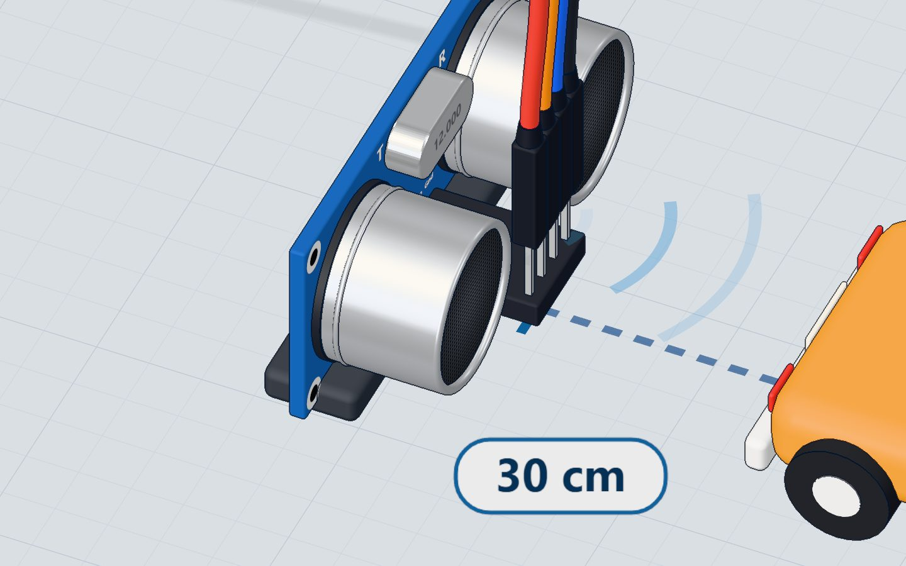
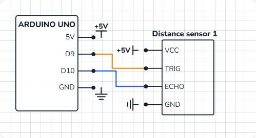

# Measure distance

## What you will build

The Arduino sends out a burst of ultrasound, listens for the echo, and prints the distance in centimetres to the Serial Monitor — about seven times a second. It is the heart of every robot that avoids walls and every car that beeps when you reverse.

## How ultrasound measures distance

The HC-SR04 has two round "eyes": one is a tiny **speaker** (the transmitter, T), the other a **microphone** (the receiver, R). They work at **40 kHz** — far too high for people to hear.

1. The Arduino sends a short **10 µs pulse** to the **TRIG** pin.
2. The sensor answers by sending eight bursts of 40 kHz sound.
3. It then holds its **ECHO** pin HIGH until the sound bounces off something and comes back.
4. The Arduino measures **how long ECHO stayed HIGH**. That time is the distance.



## The math: from microseconds to centimetres

Sound travels at about **343 metres per second** at room temperature — that is 0.0343 cm per microsecond.

The echo time covers the trip **there and back**, so we divide by two:

| Step | Formula |
|---|---|
| Distance sound travelled | time × 0.0343 cm/µs |
| Distance to the object | time × 0.0343 ÷ 2 |
| Simplified | time ÷ 58 |

So an echo that lasts **1740 µs** means 1740 ÷ 58 = **30 cm**.

> **Did you know?** Sound is about 0.6 m/s faster for every 1 °C warmer. For precise work, measure the temperature too — try combining this with the TMP36 project.

## The wiring

The HC-SR04 has four pins. No breadboard needed: four jumper wires go straight from the sensor to the UNO.

| Sensor pin | Goes to | What it does |
|---|---|---|
| VCC | 5V | Power for the sensor |
| TRIG | Pin 9 | The Arduino starts a measurement |
| ECHO | Pin 10 | The sensor reports the echo time |
| GND | GND | The return path for current |



> **Warning:** Swap VCC and GND and the sensor can be damaged. In our 3D lab it burns — try it safely there first.

## The code, line by line

```cpp
const int TRIG = 9;
const int ECHO = 10;

void setup() {
  pinMode(TRIG, OUTPUT);
  pinMode(ECHO, INPUT);
  Serial.begin(9600);
}

void loop() {
  digitalWrite(TRIG, HIGH);       // a 10 µs pulse starts a measurement
  delayMicroseconds(10);
  digitalWrite(TRIG, LOW);
  long echo = pulseIn(ECHO, HIGH); // how long the echo took, in µs
  long cm = echo / 58;
  Serial.print(cm);
  Serial.println(" cm");
  delay(150);
}
```

- **`const int TRIG = 9;`** gives pin numbers a name, so the code reads like English and a pin change is one edit.
- **`pinMode(TRIG, OUTPUT)`** — the Arduino drives TRIG. **`pinMode(ECHO, INPUT)`** — the sensor drives ECHO, the Arduino only listens.
- **`digitalWrite(TRIG, HIGH); delayMicroseconds(10); digitalWrite(TRIG, LOW);`** makes the 10 µs trigger pulse. `delayMicroseconds` is like `delay`, but a thousand times finer.
- **`pulseIn(ECHO, HIGH)`** waits for ECHO to go HIGH, times how long it stays HIGH, and returns that time in microseconds.
- **`echo / 58`** turns the time into centimetres (see the math above). `long` is used because the time can be bigger than an `int` holds.
- **`delay(150)`** gives the old echoes time to fade before the next measurement.

## Common mistakes

- **Readings of 0 or very large numbers.** Nothing is in range (2 cm to 4 m), the surface is soft (cloth absorbs sound), or it is at a steep angle.
- **TRIG and ECHO swapped.** The code triggers the wrong pin and `pulseIn` waits forever. Check the table above.
- **Measuring too fast.** Without the `delay`, an old echo can be mistaken for a new one.

## Try these challenges

1. Print **"Too close!"** when the distance is under 10 cm.
2. Show the distance in **inches** too (divide the echo time by 148).
3. Add an LED that lights when something is closer than 20 cm — that's a parking sensor. Then compare with the **Parking sensor** project in the 3D lab.

## Check yourself

::: quiz
? What does the Arduino measure to know the distance?
- How long the ECHO pin stays HIGH *
- How loud the echo is
- The voltage on the TRIG pin
= The longer the sound takes to come back, the longer ECHO stays HIGH — and the farther the object is.
? Why do we divide the echo time by 58 to get centimetres?
- Sound takes about 58 µs to go 1 cm and come back *
- The sensor counts in 58ths of a second
- 58 is the speed of sound in cm/s
= 343 m/s is 0.0343 cm/µs; there and back is 2 cm per centimetre of distance: 2 ÷ 0.0343 ≈ 58 µs.
? How long is the trigger pulse the Arduino sends?
- 10 microseconds *
- 10 milliseconds
- 1 second
= digitalWrite HIGH, delayMicroseconds(10), digitalWrite LOW: a 10 µs pulse starts each measurement.
:::

## Questions people ask

### How far can the HC-SR04 measure?
About 2 cm to 400 cm. Closer than 2 cm the echo returns before the sensor is ready to listen.

### Does it work on a 3.3 V board?
The classic HC-SR04 needs 5 V. For 3.3 V boards look for the HC-SR04P, or use a level shifter on ECHO.

### Why divide by 58?
Because sound needs about 58 µs to go 1 cm and come back (29 µs each way).

## What's next

Combine sensing and control: use the distance to light a traffic light in the **Parking sensor** project, or learn exactly [how the breadboard joins your parts](/learn/what-is-a-breadboard/).
