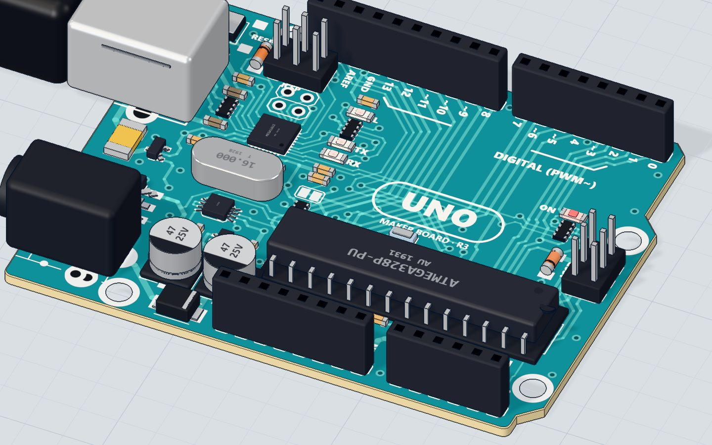

# Meet the Arduino UNO board

## What you will build

Nothing to build yet — and that is the point. You plug in the board, upload a short sketch (an Arduino program), and the tiny LED marked **L** blinks twice a second. Every time it blinks, the board counts and sends a line like `Blinks: 7` to your computer, so you can *see* the program running.

The UNO is the board most people start with. The same chip family runs 3D printers, school robots, weather stations and home-made game controllers. Learn this board well and every later project is "the same thing, plus a part".

## How it works

The UNO is a small computer on a board. In the middle sits the **ATmega328P microcontroller** — a chip with its own processor, memory and pins. You write the sketch on your computer, the USB cable carries it into the chip's memory, and from then on the board runs it by itself, even without the computer (as long as it has power).

| Inside the UNO | Value |
|---|---|
| Microcontroller | ATmega328P |
| Speed | 16 MHz (16 million steps a second) |
| Flash (where your sketch lives) | 32 KB |
| RAM (where variables live) | 2 KB |
| Working voltage | 5 V |
| Safe current per pin | 20 mA (40 mA absolute maximum) |

Pin 13 is joined on the board to a little LED marked **L**. That is why this first sketch needs no wires: when the program puts **5 V** on pin 13 (HIGH), current flows through the L LED and it lights; at **0 V** (LOW) it goes dark. In code, this LED has its own name: **`LED_BUILTIN`**.



## A tour of the board: pins and parts

Hold the board with the USB socket on the left. Here is what you see:

| Part of the board | What it does |
|---|---|
| USB socket | Power (5 V from your computer), uploading sketches, and the serial monitor |
| Power jack | Run the board from a 7–12 V adapter or battery instead of USB |
| Reset button | Starts your sketch again from the top, like turning it off and on |
| Digital pins D0–D13 | Outputs (switch 5 V or 0 V) or inputs (read HIGH or LOW) |
| Pins marked ~ (3, 5, 6, 9, 10, 11) | Can also "dim" with PWM: `analogWrite()` from 0 to 255 |
| Analog pins A0–A5 | Read any voltage from 0 to 5 V as a number from 0 to 1023 |
| 5V and 3.3V pins | Power for the parts you add |
| GND pins | Ground — the 0 V return path every circuit needs |
| ON LED | Lit whenever the board has power |
| L LED | Joined to pin 13 — you control it |
| TX and RX LEDs | Flicker when data goes to (TX) or comes from (RX) your computer |

> **Warning:** Pins D0 and D1 carry the serial connection to your computer. Keep them free in your projects, or uploads and the serial monitor can stop working.

> **Did you know?** "Analog" pins can also work as normal digital pins. Want more outputs? A0–A5 are pins 14–19.

## The code, line by line

```cpp
// The board's own LED (marked L) is on pin 13.
int blinks = 0;

void setup() {
  pinMode(LED_BUILTIN, OUTPUT);
  Serial.begin(9600);
  Serial.println("Hello from the UNO!");
}

void loop() {
  digitalWrite(LED_BUILTIN, HIGH);
  delay(500);
  digitalWrite(LED_BUILTIN, LOW);
  delay(500);
  blinks = blinks + 1;
  Serial.print("Blinks: ");
  Serial.println(blinks);
}
```

- **`// …`** is a comment: a note for people. The chip ignores it.
- **`int blinks = 0;`** makes a *variable* — a named box that holds a whole number. It starts at 0. Because it is outside any function, it keeps its value between loops.
- **`setup()`** runs **once**, when the board powers up or you press reset.
- **`pinMode(LED_BUILTIN, OUTPUT)`** makes pin 13 an output, so the program drives it.
- **`Serial.begin(9600)`** opens the serial connection to your computer at 9600 bits per second. The serial monitor must use the same speed.
- **`Serial.println("Hello from the UNO!")`** sends that text once, followed by a new line.
- **`loop()`** runs **again and again**, forever, as fast as it can.
- **`digitalWrite(LED_BUILTIN, HIGH)`** puts 5 V on pin 13: the L LED lights. **`delay(500)`** waits 500 ms, half a second.
- **`blinks = blinks + 1;`** adds one to the counter after each full blink (on + off = 1 second).
- **`Serial.print("Blinks: ")`** sends text *without* a new line; **`Serial.println(blinks)`** sends the number and ends the line. Together: `Blinks: 1`, `Blinks: 2`…

## Common mistakes

- **Nothing in the serial monitor.** The monitor's speed is not 9600. Set it to match `Serial.begin(9600)`. See [the serial monitor explained](/learn/arduino-serial-monitor-explained/).
- **Garbled characters like `⸮⸮⸮`.** Same cause: the baud rate (speed) does not match.
- **"Expected ';' before…".** A line is missing its semicolon. Every statement ends with `;` — but `void loop() {` does not.
- **`led_builtin` was not declared.** C++ cares about capitals. It must be `LED_BUILTIN`, and `pinMode`, not `pinmode`.
- **The L LED blinks, but not your way.** A brand-new UNO already runs a blink sketch from the factory. Make sure your upload really finished.

## Try these challenges

1. Change both delays to `200` and run again. How many blinks per second now?
2. Make the "on" time short and the "off" time long: a quick flash every two seconds.
3. Print a message only every tenth blink. Hint: `if (blinks % 10 == 0)`.
4. In the 3D lab, press Run and watch the L LED next to pin 13, then open the serial monitor and watch the count go up.

## Check yourself

::: quiz
? How often does the code inside loop() run?
- Once, when the board starts
- Again and again, forever *
- Only when you press the reset button
= setup() runs once; loop() repeats for as long as the board has power.
? Which pin is the L LED on the UNO joined to?
- Pin 0
- Pin A0
- Pin 13 *
= LED_BUILTIN is pin 13 on the UNO. Your first external LED circuit uses the same pin.
? What value does analogRead() give for 5 V on an analog pin?
- 255
- 1023 *
- 5000
= The analog pins turn 0–5 V into a number from 0 to 1023. (255 is the top of analogWrite.)
:::

## Questions people ask

### What is the difference between the Arduino UNO and other Arduino boards?
The UNO is the standard beginner board: 5 V, 14 digital pins and 6 analog inputs, with sockets for jumper wires. The Nano has the same chip in a smaller body; the Mega has many more pins. Code for the UNO runs on them almost unchanged.

### Can the Arduino UNO run without a computer?
Yes. Once uploaded, the sketch stays in the flash memory even when power is off. Give the board power from a USB charger or a 7–12 V adapter on the jack, and it starts running the sketch straight away.

### What does LED_BUILTIN mean?
It is a name that the Arduino software gives to the pin with the board's own LED. On the UNO it is pin 13. Using the name makes the same sketch work on boards where the LED sits on a different pin.

### Do I need to buy an Arduino to learn?
No. Our free [3D lab](/) runs the real compiled code on a simulated ATmega328P — the same chip as on the UNO — right in your browser. Buy the board when you are ready to hold it. To understand what Arduino is in the first place, read [what is Arduino](/learn/what-is-arduino/).

## What's next

You can make the board's own LED blink. Now wire your first real circuit: [blink an LED on a breadboard](/learn/blink-an-led/) with a resistor, and learn why the resistor matters.
