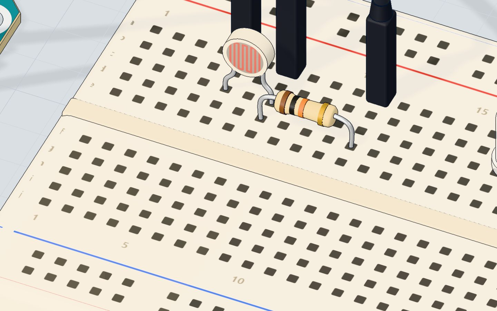
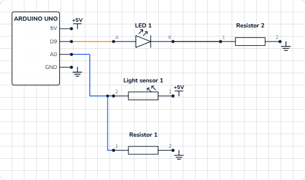

# Night light

## What you will build

A light sensor and a white LED. While the room is bright, the LED stays off. When it gets dark, the LED switches on — dimly at dusk, fully in the dark. The serial monitor prints the light level five times a second, so you can watch it change as you move the lamp.

Street lights, phone screens that dim at night, garden solar lamps and cars whose headlights switch on in a tunnel all use this idea: **measure the light, compare it with a threshold, act**.

## How it works

An **LDR** (light-dependent resistor) is a resistor that changes with light. In bright light its resistance is low; in the dark it climbs to about **1 MΩ** (a million ohms). More in [the LDR explained](/learn/ldr-light-sensor-explained/).

The Arduino cannot measure resistance directly — it measures **voltage**. So the LDR and a fixed **10 kΩ resistor** make a **voltage divider**: the LDR from 5V to A0, the 10 kΩ from A0 to GND. The two share the 5 V. When the LDR's resistance is low (bright), most of the voltage lands on the 10 kΩ, so A0 is high. When it is high (dark), A0 drops toward 0 V.

The voltage on A0 = 5 V × 10 kΩ ÷ (10 kΩ + the LDR's resistance). With the LDR our 3D lab uses (about 10 kΩ at 10 lux):

| Light | LDR resistance | Voltage on A0 | analogRead() |
|---|---|---|---|
| Desk lamp, 300 lux | ≈ 660 Ω | ≈ 4.7 V | ≈ 960 |
| Dim room, 10 lux | ≈ 10 kΩ | 2.5 V | ≈ 512 |
| Dusk, about 6 lux | ≈ 15.6 kΩ | ≈ 1.95 V | ≈ 400 — the switch point |
| Very dark, 1 lux | ≈ 63 kΩ | ≈ 0.68 V | ≈ 140 |
| Total darkness | ≈ 1 MΩ | ≈ 0.05 V | ≈ 10 |

The sketch says "dark" below **400**. Then it maps the reading to a brightness: at 400 the LED glows at level 30 (dim); at 0 it glows at 255 (full). The white LED (about 3.0 V) takes at most (5 − 3.0) V ÷ 220 Ω ≈ **9 mA**.



## The wiring

1. Push the **LDR** in with its legs in **5c** and **7c** (either way round).
2. Put the **10 kΩ** resistor from **7d** to **11d**.
3. Jumper wires: **5V → 5a**, **7a → A0**, **11a → GND**.
4. Push the **white LED** in with its long leg (+) in **18d** and its short leg in **19d**.
5. Put the **220 Ω** resistor from **19b** to **23b**.
6. Jumper wires: **pin 9 → 18a**, **23a → GND**.

| Part pin | Goes to | What it does |
|---|---|---|
| LDR leg (5c) | 5V | The top of the divider |
| LDR leg (7c) and 10 kΩ | A0 | The middle of the divider: the light level |
| 10 kΩ other leg (11d) | GND | The bottom of the divider |
| LED long leg (+) | Pin 9 (~) | PWM sets the night light's brightness |
| LED short leg (−) | 220 Ω → GND | Limits the current |



> **Tip:** Swap the LDR and the 10 kΩ, and the reading flips: brighter gives *lower* numbers. Both work — just know which one you built.

## The code, line by line

```cpp
const int SENSOR = A0;
const int LED = 9;
const int DARK = 400;   // below this it counts as dark

void setup() {
  pinMode(LED, OUTPUT);
  Serial.begin(9600);
}

void loop() {
  int light = analogRead(SENSOR);   // brighter = higher
  Serial.print("light ");
  Serial.println(light);
  if (light < DARK) {
    // the darker it is, the brighter the night light
    analogWrite(LED, map(light, 0, DARK, 255, 30));
  } else {
    analogWrite(LED, 0);
  }
  delay(200);
}
```

- **`const int DARK = 400;`** is the **threshold**: the number where "light" becomes "dark". Giving it a name makes it easy to tune.
- **`analogRead(SENSOR)`** reads the divider: 0–1023, brighter = higher.
- **`if (light < DARK) { … } else { … }`** — the program makes a decision. If it is darker than 400, run the first block; otherwise, run the second.
- **`map(light, 0, DARK, 255, 30)`** turns the range 0–400 into 255–30, *backwards*: the darker (smaller) the reading, the bigger the brightness. At 140 it gives about 177.
- **`analogWrite(LED, 0)`** keeps the LED off while it is bright.
- **`delay(200)`** checks five times a second.

## Common mistakes

- **The LED is always on, or never.** Your room is brighter or darker than the lab's. Watch the serial monitor in your normal light and in the dark, and set `DARK` between the two numbers.
- **The reading barely changes.** The 10 kΩ is missing or in the wrong strip, so there is no divider. A0 must sit between the LDR and the 10 kΩ.
- **It works backwards.** The LDR and the resistor are swapped (see the tip above). Swap them back, or change `<` to `>`.
- **The LED flickers at dusk.** The reading wobbles around 400. Use two thresholds: on below 380, off above 420 (this is called *hysteresis*).

## Try these challenges

1. Print `"dark"` or `"bright"` next to the number.
2. Change `400` to a different threshold and find the value that suits your room.
3. Make the LED simply on or off with `digitalWrite`, without `map()`. Which do you prefer?
4. In the 3D lab, drag the desk lamp away from the sensor, or set the light in lux in the sensor's window, and compare the numbers with the table above.

## Check yourself

::: quiz
? What happens to an LDR's resistance when it gets darker?
- It goes down
- It goes up *
- It stays the same
= Darkness raises the resistance, to about 1 MΩ in total darkness.
? Why is the 10 kΩ resistor needed?
- To protect the LDR from burning
- To make a voltage divider, so A0 sees a voltage that follows the light *
- To make the LED dimmer
= analogRead() measures voltage. The divider turns the LDR's resistance into a voltage.
? With this sketch, what does the LED do when analogRead() gives 700?
- It glows at full brightness
- It glows dimly
- It is off *
= 700 is not below DARK (400), so the else block runs: analogWrite(LED, 0).
:::

## Questions people ask

### How do I connect an LDR to an Arduino?
Put the LDR between 5V and an analog pin (A0), and a 10 kΩ resistor between that pin and GND. `analogRead(A0)` then gives a higher number in brighter light.

### What resistor should I use with an LDR?
Pick one close to the LDR's resistance in the light you care about. 10 kΩ is a good all-round choice for a typical LDR in a room; a bigger one makes it more sensitive in the dark.

### Can an LDR measure light in lux?
Only roughly. LDRs differ a lot from part to part and react slowly. They are great for "brighter or darker" decisions; for real lux values use a light sensor module made for it.

### Why does my night light flicker on and off?
The reading hovers right at the threshold, so tiny changes switch it back and forth. Use two thresholds (switch on below one, off above another) or average a few readings.

## What's next

You have used light as an input. Next, sense **distance** with sound you cannot hear: the [HC-SR04 ultrasonic sensor](/learn/measure-distance-hc-sr04/).
