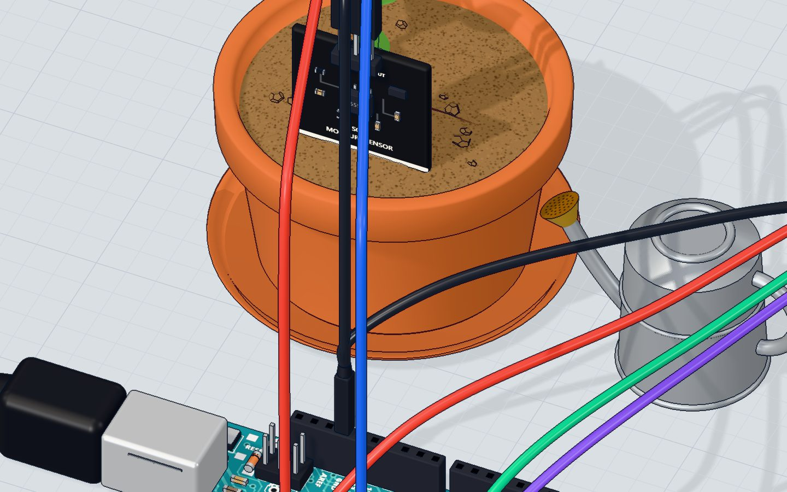
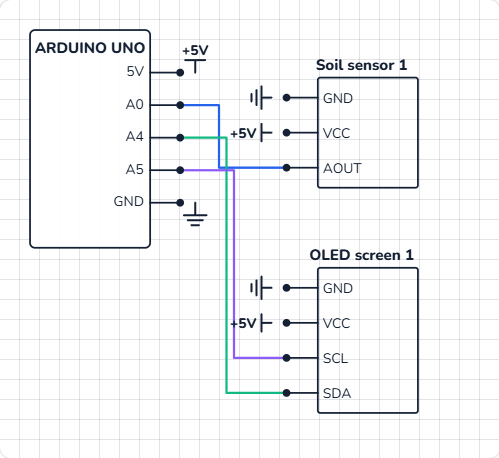

# Smart plant

## What you will build

A soil sensor sits in a plant pot. Twice a second the Arduino reads it, turns the reading into a **moisture percentage from 0 to 100 %**, and draws it on a small OLED screen: the number in big digits, a bar that fills up, and a message. Below 30 % it asks **"Water me!"**, above 85 % it warns **"Too wet!"**, and in between it is **"Happy :)"**.

Farms, greenhouses and smart gardens use the same idea at a bigger scale — often switching a water pump on automatically when the soil gets dry.

## How it works

### The capacitive soil sensor

A **capacitive** soil sensor has no bare metal in the soil. Its blade is a capacitor: water near it changes how much charge it can hold, and a small circuit on the board turns that into a voltage on its **AOUT** pin. The rule is easy to remember: **wetter soil = lower voltage**.

| Soil | Voltage on AOUT | `analogRead()` | Percent |
|---|---|---|---|
| Dry air | ≈ 2.54 V | ≈ 520 | 0 % |
| Dry soil (the lab's start) | ≈ 2.22 V | ≈ 455 | 25 % |
| "Water me!" limit | ≈ 2.16 V | ≈ 442 | 30 % |
| "Too wet!" limit | ≈ 1.46 V | ≈ 299 | 85 % |
| In water | ≈ 1.27 V | ≈ 260 | 100 % |

Because nothing metal touches the soil, it does not rust like the cheap two-prong sensors. More in [the capacitive soil sensor explained](/learn/capacitive-soil-moisture-sensor/).

### From a reading to a percentage: map() and constrain()

`map(raw, 520, 260, 0, 100)` stretches one range onto another: 520 becomes 0, 260 becomes 100, and everything between is scaled in a straight line. Notice the range goes **down** (520 to 260) while the percentage goes **up** — `map()` is happy with that.

If the sensor reads 530 in very dry air, `map()` would give −3 %. **`constrain(x, 0, 100)`** clamps anything below 0 to 0 and above 100 to 100.

### The OLED screen and I²C

The **0.96" OLED** has 128 × 64 tiny pixels that make their own light — no backlight. It talks over **I²C**, a bus that needs only **two wires**: **SDA** (data) and **SCL** (clock). On the Arduino UNO they are pins **A4** and **A5**. The screen has an address (0x3C), so other I²C parts could share the same two wires.

The code draws a picture in the UNO's memory first, and **`display()`** sends the whole picture to the screen in one go.



## The wiring

No breadboard needed: both modules connect straight to the UNO with jumper wires.

1. Soil sensor: **VCC → 5V**, **GND → GND**, **AOUT → A0**.
2. OLED: **VCC → 5V**, **GND → GND**, **SDA → A4**, **SCL → A5**.
3. Push the sensor's blade into the soil up to the line — keep the electronics on top dry.

| Part pin | Goes to | What it does |
|---|---|---|
| Soil VCC | 5V | Powers the sensor (it works from 3.0 V up) |
| Soil GND | GND | Return path |
| Soil AOUT | A0 | The moisture, as a voltage |
| OLED VCC | 5V | Powers the screen |
| OLED GND | GND | Return path |
| OLED SDA | A4 | I²C data |
| OLED SCL | A5 | I²C clock |



> **Warning:** Swap VCC and GND on a module and it can be damaged — in our 3D lab it burns. Read the labels on the pins, not the wire colours.

## The code, line by line

```cpp
#include <OLED.h>
OLED screen;
const int SENSOR = A0;
const int DRY = 520, WET = 260;   // readings in dry air and in water

void setup() {
  screen.begin();
  Serial.begin(9600);
}

void loop() {
  int raw = analogRead(SENSOR);
  int percent = constrain(map(raw, DRY, WET, 0, 100), 0, 100);
  Serial.println(percent);

  screen.clearDisplay();
  screen.setTextSize(3);
  screen.setCursor(0, 0);
  screen.print(percent);
  screen.print("%");
  screen.drawRect(0, 28, 128, 10, WHITE);
  screen.fillRect(2, 30, percent * 124 / 100, 6, WHITE);
  screen.setTextSize(2);
  screen.setCursor(0, 46);
  if (percent < 30) screen.print("Water me!");
  else if (percent > 85) screen.print("Too wet!");
  else screen.print("Happy :)");
  screen.display();
  delay(500);
}
```

- **`#include <OLED.h>`** and **`OLED screen;`** — our 3D lab's own small OLED library for the SSD1306 screen (see the questions below for real hardware).
- **`const int DRY = 520, WET = 260;`** — your sensor's two **calibration** readings: in dry air and in a glass of water.
- **`screen.begin()`** wakes the screen up at I²C address 0x3C.
- **`constrain(map(raw, DRY, WET, 0, 100), 0, 100)`** — the reading becomes 0–100 %, clamped so it never goes outside.
- **`screen.clearDisplay()`** wipes the picture in memory (not yet the screen).
- **`setTextSize(3)`** — each letter is 6 × 8 pixels at size 1, so size 3 makes them 18 × 24. **`setCursor(0, 0)`** starts at the top-left corner.
- **`drawRect(0, 28, 128, 10, WHITE)`** draws the bar's outline across the full width, 28 pixels down. **`fillRect(2, 30, percent * 124 / 100, 6, WHITE)`** fills it: at 100 % the fill is 124 pixels wide, at 50 % it is 62.
- **`if … else if … else`** picks exactly one message.
- **`screen.display()`** finally sends the whole 128 × 64 picture to the screen.

## Common mistakes

- **The screen stays black.** SDA and SCL are swapped (SDA → A4, SCL → A5), or `display()` is missing — nothing shows until you call it.
- **The percent is always 0 or 100.** Your sensor's readings differ. Calibrate: print `raw` in dry air and in water, and put those numbers in `DRY` and `WET`.
- **The numbers jump around.** The sensor is pushed in only a little, or the soil is loose. Push it in up to the line and press the soil around it.
- **Old pixels stay on the screen.** You forgot `clearDisplay()` at the start of each loop.

## Try these challenges

1. Change the **"Water me!"** limit to 40 %.
2. Print the raw reading as well as the percent to the Serial Monitor, and **calibrate** your own `DRY` and `WET`.
3. Add an LED on a pin that lights when the plant needs water (see [Blink an LED](/learn/blink-an-led/)).
4. In the 3D lab, hold the **watering can** over the pot and watch the bar fill up; then type a moisture value in the sensor's window.

## Check yourself

::: quiz
? The soil gets wetter. What happens to the sensor's reading?
- It goes up
- It goes down *
- It stays the same
= A capacitive sensor gives a lower voltage the wetter the soil: about 520 in dry air, about 260 in water.
? Which two UNO pins does the I²C OLED use?
- 2 and 3
- A0 and A1
- A4 (SDA) and A5 (SCL) *
= On the Arduino UNO, I²C is on A4 (SDA, data) and A5 (SCL, clock).
? What does constrain(x, 0, 100) do?
- Keeps x between 0 and 100 *
- Turns x into a percentage
- Rounds x to a whole number
= Anything below 0 becomes 0, anything above 100 becomes 100.
:::

## Questions people ask

### Which library do I use for the OLED on a real Arduino?
Our 3D lab uses its own small `OLED.h` library so the code stays short. On a real board, install **Adafruit SSD1306** and **Adafruit GFX** from the Library Manager. They have the same drawing functions — `clearDisplay()`, `setTextSize()`, `setCursor()`, `drawRect()`, `fillRect()`, `display()` — but the setup is longer: `Adafruit_SSD1306 screen(128, 64, &Wire, -1);` and `screen.begin(SSD1306_SWITCHCAPVCC, 0x3C);`, plus `screen.setTextColor(WHITE);`. See [the SSD1306 OLED guide](/learn/ssd1306-oled-display-arduino/).

### How do I calibrate a capacitive soil moisture sensor?
Print `analogRead(A0)` to the Serial Monitor. Hold the sensor in dry air and note the number (your `DRY`), then stand it in a glass of water up to the line and note that (your `WET`). Every sensor is a little different.

### Can the Arduino water the plant by itself?
Yes — add a small 5 V water pump, driven through a transistor exactly like [the DC motor project](/learn/dc-motor-transistor-arduino/), and switch it on for a few seconds when the percentage drops below your limit.

### Why is a capacitive sensor better than a resistive one?
A resistive sensor passes current through the soil between two bare metal prongs, which corrode within weeks. A capacitive sensor is sealed, so it lasts.

## What's next

Next, measure **force** instead of moisture: build [a strength tester with a force sensor, a servo needle and a bell](/learn/force-sensor-strength-tester-arduino/).
