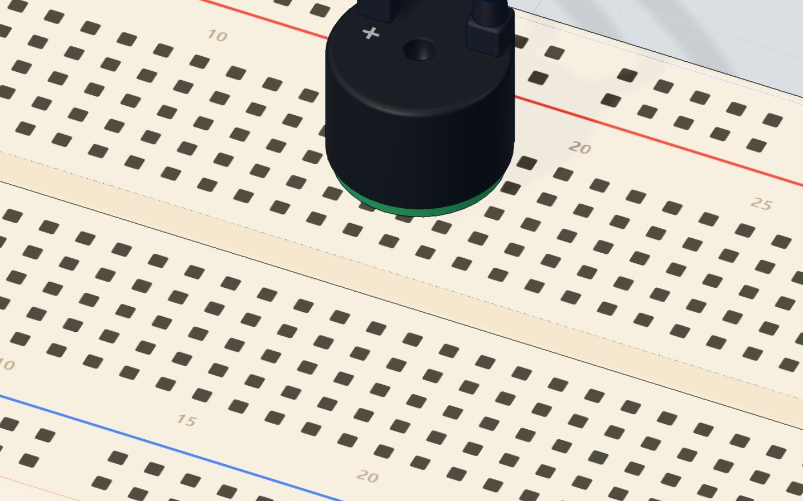
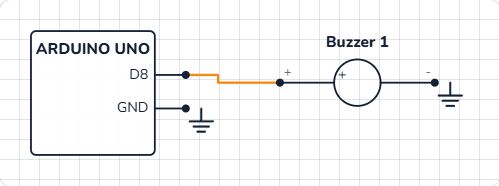

# Play a tune

## What you will build

A small round buzzer that plays the first line of **"Ode to Joy"** by Beethoven — fifteen notes — then pauses for a second and a half and plays it again. The serial monitor prints the frequency of each note as it plays.

Buzzers like this beep in microwaves, alarm clocks, washing machines and toys. The same code idea — a list of notes and a list of lengths — is how ringtones and old video-game music were made.

## How it works

A **passive piezo buzzer** contains a thin disc that bends a tiny bit every time the voltage on it changes. One change makes one click. Many clicks a second make a **tone** — and the faster the clicks, the higher the note. More in [the passive buzzer explained](/learn/passive-buzzer-explained/).

The Arduino function **`tone(pin, frequency)`** does the switching for you: it flips the pin HIGH and LOW exactly that many times per second, in the background, while your program carries on.

A musical note *is* just a frequency, measured in **hertz (Hz)**, cycles per second:

| Note | Name in the song | Frequency | One cycle lasts |
|---|---|---|---|
| C | Do | 262 Hz | 3.8 ms |
| D | Re | 294 Hz | 3.4 ms |
| E | Mi | 330 Hz | 3.0 ms |
| F | Fa | 349 Hz | 2.9 ms |
| G | Sol | 392 Hz | 2.6 ms |

> **Did you know?** The A above middle C is **440 Hz** — orchestras tune to it. Double any frequency and you get the same note one **octave** higher: 880 Hz is A again.

The tune's timing: one beat is **300 ms**. Each note sounds for its beats minus 30 ms, so repeated notes (E E, G G) are heard as two separate notes, not one long one. The whole line is 16 beats = 4.8 seconds.



## The wiring

Only two wires, and no resistor: a piezo buzzer draws almost no steady current.

1. Push the **buzzer** into the breadboard with its **+** leg in **15b** and its other leg in **18b**.
2. Jumper wire from **pin 8 → 15a**.
3. Jumper wire from **18a → GND**.

| Part pin | Goes to | What it does |
|---|---|---|
| Buzzer + | Pin 8 | tone() switches it on and off to make the note |
| Buzzer − | GND | The return path |



> **Tip:** Make sure you have a **passive** buzzer. An *active* buzzer has its own beeper inside and plays only one fixed tone, whatever frequency you ask for.

## The code, line by line

```cpp
const int BUZZER = 8;
// "Ode to Joy" (Beethoven): E E F G G F E D C C D E E D D
const int NOTES[] = { 330, 330, 349, 392, 392, 349, 330, 294, 262, 262, 294, 330, 330, 294, 294 };
const int BEATS[] = { 1, 1, 1, 1, 1, 1, 1, 1, 1, 1, 1, 1, 1, 1, 2 };
const int COUNT = 15;
const int BEAT = 300; // ms

void setup() {
  Serial.begin(9600);
}

void loop() {
  for (int i = 0; i < COUNT; i++) {
    int ms = BEATS[i] * BEAT;
    tone(BUZZER, NOTES[i], ms - 30);
    Serial.println(NOTES[i]);
    delay(ms);
  }
  delay(1500);
}
```

- **`const int NOTES[] = { 330, … };`** is an **array**: one name for a whole list of numbers. `NOTES[0]` is the first (330), `NOTES[14]` the last. Counting starts at **0**.
- **`BEATS[]`** is a second list, the same length: how many beats each note lasts. Only the last note is 2 beats long.
- **`COUNT = 15`** is how many notes there are. **`BEAT = 300`** is the length of one beat in milliseconds — the tempo.
- **`for (int i = 0; i < COUNT; i++)`** repeats the block 15 times, with `i` going 0, 1, 2 … 14. `i++` means "add one to i".
- **`int ms = BEATS[i] * BEAT;`** works out this note's length: 300 ms, or 600 ms for the last one.
- **`tone(BUZZER, NOTES[i], ms - 30)`** starts the note and stops it by itself after `ms − 30` milliseconds.
- **`delay(ms)`** waits for the whole note, including the 30 ms of silence, before the next one. (`tone()` does not wait by itself.)
- **`delay(1500)`** after the loop: a pause before the tune starts again.

## Common mistakes

- **Only clicks, or one fixed beep.** You have an *active* buzzer. Use a passive one for tunes.
- **All the notes blur into one.** Without the `- 30`, repeated notes join up. Keep a short gap between notes.
- **The tune plays too fast and sounds wrong.** `delay(ms)` is missing, so every `tone()` replaces the last one immediately.
- **Silence.** The buzzer is on a different pin than the code says (8), or both legs are in the same strip. In the 3D lab, also check that sound is on in the toolbar.

## Try these challenges

1. Change the tempo: try `BEAT = 200` (faster) and `BEAT = 450` (slower).
2. Play it one octave higher by doubling the frequency: `tone(BUZZER, NOTES[i] * 2, ms - 30);`.
3. Write your own tune: change both arrays and `COUNT`. Keep the two arrays the same length!
4. In the 3D lab, turn sound on in the toolbar, press Run, and watch the frequencies scroll by in the serial monitor.

## Check yourself

::: quiz
? What makes a higher note on a passive buzzer?
- A higher voltage on the pin
- More clicks per second (a higher frequency) *
- A longer delay()
= The pitch is the frequency: how many times a second the pin flips.
? In this sketch, what is NOTES[0]?
- 0
- 330 *
- 294
= Arrays count from 0, so NOTES[0] is the first number in the list.
? Why is there a delay(ms) after tone()?
- tone() starts the sound but does not wait, so the program must wait for the note *
- It makes the note louder
- To let the buzzer cool down
= Without it, the loop would rush through all 15 notes in an instant.
:::

## Questions people ask

### What is the difference between an active and a passive buzzer?
An active buzzer has a built-in oscillator: give it 5 V and it beeps at one fixed pitch. A passive buzzer needs a changing signal, which `tone()` provides — so it can play any note.

### Does a buzzer need a resistor on Arduino?
A small passive piezo buzzer, like this one, does not: it draws almost no steady current. Some people add 100 Ω to make it a little quieter.

### Can I play two notes at once with tone()?
No. `tone()` works on one pin at a time; starting a new tone stops the old one. For chords you need extra hardware or a special library.

### What are the frequencies of musical notes for Arduino?
Middle C is 262 Hz, then D 294, E 330, F 349, G 392, A 440, B 494 and the next C 523. Double them for the octave above, halve them for the octave below.

## What's next

The buzzer plays a song by itself. Now put *you* in charge: eight buttons become keys in the [Arduino mini piano](/learn/arduino-piano-buttons-buzzer/).
