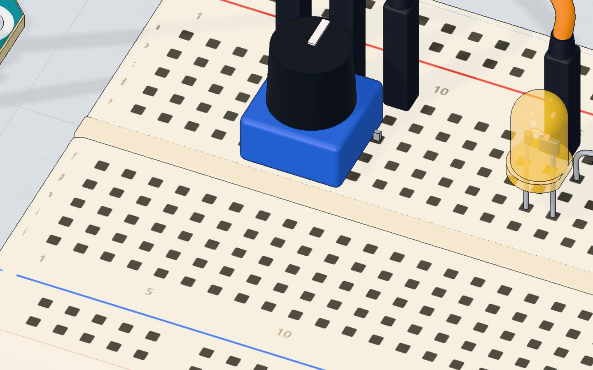
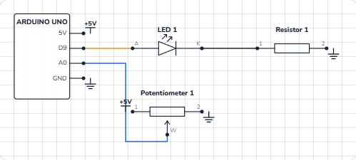

# Turn a knob

## What you will build

A knob (a **potentiometer**) and a yellow LED. Turn the knob one way and the LED glows brighter; turn it back and it fades out. The serial monitor shows both numbers live, like `knob 512  ->  LED 127`.

Knobs like this are everywhere: volume controls, oven dials, joysticks (two knobs in one), and the speed control on a fan. Any time you want a person to choose *how much*, a potentiometer is the cheapest way.

## How it works

A potentiometer is a **10 kΩ resistor with a sliding contact**, called the **wiper**. The two outer legs go to **5 V** and **GND**. As you turn the knob, the wiper slides along the resistor, and the middle leg gives any voltage between 0 and 5 V. This is a *voltage divider*. More in [what is a potentiometer](/learn/what-is-a-potentiometer/).

The UNO reads that voltage on **A0** with `analogRead()`. Its converter splits 0–5 V into **1024 steps**, so each step is about 4.9 mV:

| Knob position | Voltage on A0 | analogRead() | map() → LED |
|---|---|---|---|
| All the way to GND | 0 V | 0 | 0 (off) |
| A quarter | 1.25 V | ≈ 256 | ≈ 63 |
| Middle | 2.5 V | ≈ 512 | ≈ 127 |
| All the way to 5 V | 5 V | 1023 | 255 (full) |

To dim the LED, the program uses **PWM** (pulse-width modulation): pin 9 switches on and off hundreds of times a second. `analogWrite(9, 127)` keeps it on about half the time, so the LED looks half as bright. Only the pins marked **~** (3, 5, 6, 9, 10, 11) can do this. See [PWM explained](/learn/pwm-explained-analogwrite/).

At full brightness the yellow LED (about 2.0 V) takes (5 − 2.0) V ÷ 220 Ω ≈ **14 mA** — safe for the LED and the pin.



## The wiring

1. Push the potentiometer into the breadboard with its three legs in **5c, 7c and 9c**.
2. Jumper wires: **5V → 5a**, **7a → A0** (the middle leg), **9a → GND**.
3. Push the **yellow LED** in with its long leg (+) in **15d** and its short leg in **16d**.
4. Put the **220 Ω** resistor from **16b** to **20b**.
5. Jumper wires: **pin 9 → 15a**, **20a → GND**.

| Part pin | Goes to | What it does |
|---|---|---|
| Potentiometer outer leg (5c) | 5V | The top of the divider |
| Potentiometer wiper (7c) | A0 | The voltage you set, read by the UNO |
| Potentiometer outer leg (9c) | GND | The bottom of the divider |
| LED long leg (+) | Pin 9 (~) | PWM dims the LED |
| LED short leg (−) | 220 Ω → GND | Limits the current |



> **Tip:** If the LED gets brighter the "wrong" way, swap the 5V and GND wires on the outer legs. The middle wire stays on A0.

## The code, line by line

```cpp
const int KNOB = A0;
const int LED = 9;   // a ~ pin: it can dim

void setup() {
  pinMode(LED, OUTPUT);
  Serial.begin(9600);
}

void loop() {
  int reading = analogRead(KNOB);                // 0 … 1023
  int brightness = map(reading, 0, 1023, 0, 255); // 0 … 255
  analogWrite(LED, brightness);
  Serial.print("knob ");
  Serial.print(reading);
  Serial.print("  ->  LED ");
  Serial.println(brightness);
  delay(100);
}
```

- **`const int KNOB = A0;`** names the analog pin. **`LED = 9`** — a ~ pin, so it can dim.
- **`analogRead(KNOB)`** measures the voltage on A0 and returns **0 to 1023**.
- **`map(reading, 0, 1023, 0, 255)`** rescales one range to another: 0 stays 0, 1023 becomes 255, and everything in between moves in proportion. It uses whole numbers, so 512 becomes 127, not 127.6.
- **`analogWrite(LED, brightness)`** sets the PWM level, **0** (always off) to **255** (always on). You do not need `analogRead`'s 0–1023 here: `analogWrite` only goes to 255.
- The four **`Serial.print`** lines build one line of text: `knob 512  ->  LED 127`. Only the last one is `println`, which ends the line.
- **`delay(100)`** reads ten times a second — fast enough to feel instant, slow enough to read the monitor.

## Common mistakes

- **The LED is either fully on or fully off.** It is on a pin without **~**. Move it to pin 9 (or 3, 5, 6, 10, 11) — wire *and* code.
- **The reading jumps around randomly.** The wiper is not on A0, so the pin floats. Check that the *middle* leg goes to A0.
- **The reading is stuck at 0 or 1023.** One outer leg is missing its wire, or the middle leg is wired to 5V or GND by mistake.
- **`analogWrite(LED, reading)` without map().** Values above 255 wrap around, so the LED goes bright, dark, bright as you turn. Always scale with `map()` (or divide by 4).

## Try these challenges

1. Flip the direction in code: `map(reading, 0, 1023, 255, 0)`.
2. Make the LED blink, with the knob setting the speed: `delay(reading);` between on and off.
3. Light the LED only when the knob is past halfway (`if (reading > 512)`).
4. In the 3D lab, drag around the knob, or type **512** in its number box, and compare the serial monitor with the table above.

## Check yourself

::: quiz
? What range of numbers does analogRead() return on the UNO?
- 0 to 255
- 0 to 1023 *
- 0 to 5
= The converter has 10 bits: 2¹⁰ = 1024 steps, numbered 0 to 1023.
? Why is the LED on pin 9 and not on pin 8?
- Pin 8 cannot be an output
- Pin 9 is a ~ pin that can do PWM *
- Pin 9 gives more current
= Only the ~ pins (3, 5, 6, 9, 10, 11) can dim with analogWrite().
? What does map(1023, 0, 1023, 0, 255) give?
- 1023
- 4
- 255 *
= map() moves the value from the first range to the second: the top of one becomes the top of the other.
:::

## Questions people ask

### How do I connect a potentiometer to an Arduino?
Outer legs to 5V and GND, the middle leg (the wiper) to an analog pin such as A0. Then `analogRead(A0)` gives 0–1023 as you turn the knob. It does not matter which outer leg gets 5V; swapping them only reverses the direction.

### What value potentiometer should I use with Arduino?
10 kΩ is the usual choice and what this project uses. Anything from about 1 kΩ to 100 kΩ works; smaller values waste more current, much bigger ones give noisier readings.

### Why use map() instead of dividing by 4?
For 0–1023 to 0–255, `reading / 4` gives the same result. `map()` is clearer and works for any ranges — for example 0–1023 to a servo angle of 0–180.

### Can analogWrite() output a real analog voltage?
No. On the UNO it makes PWM: fast on/off pulses at 5 V. An LED or motor averages them, so they behave as if the voltage were lower.

## What's next

One LED, one brightness. Now control three at once and mix any colour you like: [the RGB LED project](/learn/rgb-led-arduino/).
