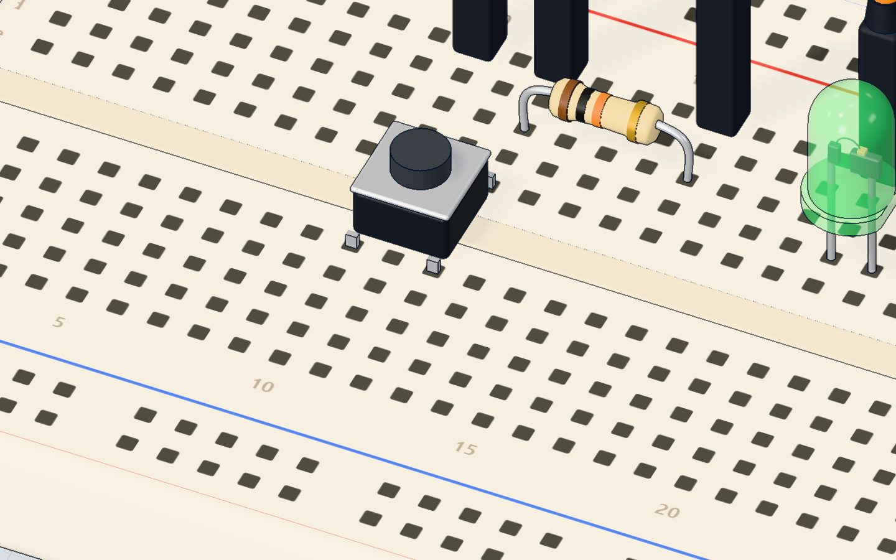
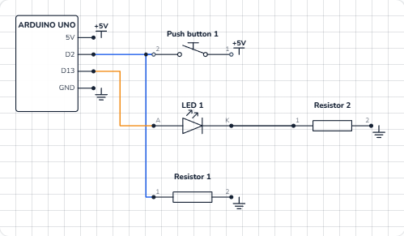

# Push a button

## What you will build

A push button and a green LED. Hold the button and the LED lights; let go and it turns off. The sketch also writes **pressed** or **released** to the serial monitor — but only when something *changes*, not thousands of times a second.

This is your first **input**: the program reacts to the world instead of just following a timetable. Doorbells, keyboards, game controllers and the "start" button on a microwave all work this way.

## How it works

A push button is a switch with a spring. Press it and two metal contacts touch; let go and they spring apart. In this circuit the button sits between **5 V** and **pin 2**:

- **Pressed:** 5 V reaches pin 2. `digitalRead(2)` gives **HIGH**.
- **Released:** the button is open. A **10 kΩ resistor** from pin 2 to GND gently pulls the pin down to 0 V. `digitalRead(2)` gives **LOW**.

Why the resistor? Without it, a released button leaves pin 2 connected to *nothing*. An input pin with nothing on it "floats": it picks up tiny charges from your hand and nearby wires and reads HIGH, LOW, HIGH at random. The resistor gives the pin a clear LOW. It is called a **pull-down resistor** because it pulls the pin down to ground. Read more in [pull-up and pull-down resistors](/learn/pull-up-pull-down-resistors/).

| | Value |
|---|---|
| Pin 2 when pressed | 5 V → HIGH |
| Pin 2 when released | 0 V (through 10 kΩ) → LOW |
| Current through the 10 kΩ when pressed | 5 V ÷ 10 000 Ω = **0.5 mA** |
| Green LED current | (5 − 2.1) V ÷ 220 Ω ≈ **13 mA** |

The 10 kΩ is big on purpose: when you press, 5 V meets GND through it, and a big resistor keeps that current tiny. A 0 Ω "resistor" there would be a short circuit.



## The wiring

The button has four legs and sits **across the middle gap** of the breadboard, in columns 10 and 12. The legs facing each other across the gap are always joined; pressing joins column 10 to column 12. See [how a push button works](/learn/how-a-push-button-works/).

1. Push the button in across the gap, legs in **10e, 12e, 10f, 12f**.
2. Put the **10 kΩ** resistor from **12c** to **16c**.
3. Jumper wires: **5V → 10a**, **pin 2 → 12a**, **16a → GND**.
4. Push the **green LED** in with its long leg (+) in **20d** and its short leg in **21d**.
5. Put the **220 Ω** resistor from **21b** to **25b**.
6. Jumper wires: **pin 13 → 20a**, **25a → GND**.

| Part pin | Goes to | What it does |
|---|---|---|
| Button, column 10 | 5V | Brings 5 V to the button |
| Button, column 12 | Pin 2 | The pin that reads the button |
| 10 kΩ resistor | Column 12 → column 16 → GND | Pull-down: keeps pin 2 LOW when released |
| LED long leg (+) | Pin 13 | The program switches the LED |
| LED short leg (−) | 220 Ω → GND | The resistor limits the current |



> **Did you know?** Pin 13 also drives the board's own **L** LED, so it lights together with the green one.

## The code, line by line

```cpp
const int BUTTON = 2;
const int LED = 13;
int was = LOW;

void setup() {
  pinMode(BUTTON, INPUT);   // the 10 kΩ resistor pulls it down to LOW
  pinMode(LED, OUTPUT);
  Serial.begin(9600);
}

void loop() {
  int now = digitalRead(BUTTON);
  digitalWrite(LED, now);
  if (now != was) {         // only report a change
    Serial.println(now == HIGH ? "pressed" : "released");
    was = now;
  }
}
```

- **`const int BUTTON = 2;`** and **`LED = 13`** give the pins names. **`int was = LOW;`** remembers what the button was last time.
- **`pinMode(BUTTON, INPUT)`** makes pin 2 an input: the program only *reads* it.
- **`digitalRead(BUTTON)`** returns **HIGH** (1) or **LOW** (0). The result goes into `now`.
- **`digitalWrite(LED, now)`** copies the button to the LED: HIGH in, HIGH out.
- **`if (now != was)`** — `!=` means "is not equal". This is true only in the moment the button changes.
- **`now == HIGH ? "pressed" : "released"`** is a short if/else: *if* `now` is HIGH, use "pressed", *otherwise* "released".
- **`was = now;`** stores the new state, so the same change is not reported twice.

## Common mistakes

- **The LED flickers or turns on by itself.** The pull-down is missing or in the wrong strip, so pin 2 floats. The 10 kΩ must join pin 2's strip to GND.
- **The LED is always on.** The button is turned the wrong way, so 5 V and pin 2 are in legs that are *always* joined. Put it across the gap as shown, or turn it a quarter turn.
- **One press prints "pressed" several times.** A real button's contacts bounce for a few milliseconds. Add `delay(20);` at the end of `loop()` as a simple fix (this is called *debouncing*).
- **Nothing happens at all.** The button is not across the gap, or the wire goes to the wrong pin. The code reads pin 2.

## Try these challenges

1. Swap the meaning: make the LED **off** while the button is held (hint: `digitalWrite(LED, !now);`).
2. Count presses and print the number each time, like `press 3`.
3. Make a toggle: one press turns the LED on, the next press turns it off.
4. In the 3D lab, use **Keep it pressed** in the button's window and watch the serial monitor print just one line.

## Check yourself

::: quiz
? What does the 10 kΩ pull-down resistor do?
- It makes the LED brighter
- It holds pin 2 at LOW when the button is not pressed *
- It protects the button from too much current
= Without it, the input floats and reads random values when the button is open.
? What does digitalRead() return?
- A number from 0 to 1023
- HIGH or LOW *
- The voltage in volts
= digitalRead() only knows two states. For in-between values, use analogRead() on an analog pin.
? Why does the sketch compare now with was?
- To print a message only when the button changes *
- To make the LED blink
- To debounce the button
= If it printed every loop, the serial monitor would fill with thousands of lines a second.
:::

## Questions people ask

### Do I need a resistor for a push button on Arduino?
Yes — either an external pull-down (like here) or a pull-up. The easy alternative is the UNO's built-in pull-up: `pinMode(2, INPUT_PULLUP)`, with the button between pin 2 and GND. Then a pressed button reads LOW. The [piano project](/learn/arduino-piano-buttons-buzzer/) uses exactly that.

### Why does my button read random values?
Because the pin is floating — connected to nothing when the button is open. Add a 10 kΩ pull-down to GND, or use `INPUT_PULLUP`.

### Which way round does a 4-leg push button go?
Across the breadboard's middle gap. The two legs facing each other across the gap are always connected; pressing connects the left pair to the right pair. If the button seems "always pressed", turn it a quarter turn.

### Can I use any pin for a button?
Yes. Any digital pin from 2 to 13 works, and the analog pins A0–A5 can read buttons too. Avoid pins 0 and 1: they carry the serial monitor.

## What's next

A button is either on or off. Next, read a value **in between**: turn a [potentiometer knob](/learn/potentiometer-arduino/) and dim an LED smoothly.
