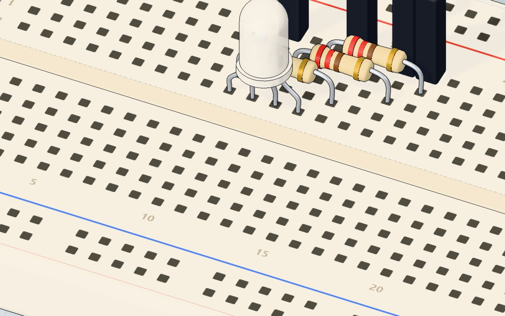
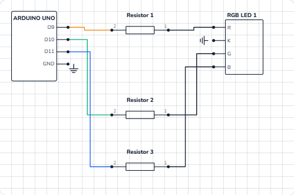

# Mix colours

## What you will build

An RGB LED that steps through six colours — **red, orange, yellow, green, sky blue and purple** — each for 0.8 seconds, forever. The serial monitor names each colour as it appears.

The same trick lights the "breathing" LED on a game controller, smart bulbs that change colour from your phone, and — with millions of tiny dots — every phone, TV and computer screen. Each pixel on your screen is a red, a green and a blue light mixed in different amounts.

## How it works

An RGB LED holds **three LEDs under one milky lens**: red, green and blue. This one is **common cathode**: the three share one minus leg (the longest), which goes to GND. Each colour has its own plus leg, its own 220 Ω resistor and its own PWM pin. More in [how an RGB LED works](/learn/how-an-rgb-led-works/).

Light **adds up**. Mixing light is not like mixing paint:

| Red | Green | Blue | You see |
|---|---|---|---|
| 255 | 0 | 0 | Red |
| 255 | 255 | 0 | Yellow |
| 0 | 255 | 255 | Cyan |
| 255 | 0 | 255 | Magenta |
| 255 | 255 | 255 | White |

Each number is a PWM level from **0** (off) to **255** (fully on). With 256 levels for each of three colours, that is 256 × 256 × 256 ≈ **16.7 million** combinations.

The three colours need different voltages, so with the same 220 Ω resistor they get different currents:

| Colour | LED voltage | Current at 255 |
|---|---|---|
| Red | ≈ 2.0 V | (5 − 2.0) ÷ 220 ≈ **14 mA** |
| Green | ≈ 3.0 V | (5 − 3.0) ÷ 220 ≈ **9 mA** |
| Blue | ≈ 3.0 V | (5 − 3.0) ÷ 220 ≈ **9 mA** |

All three together: about 32 mA — fine, because each pin carries only its own colour.



## The wiring

The RGB LED's legs, from left to right: **R, K (the longest), G, B**.

1. Push the RGB LED in with its legs in **10e (R), 11e (K), 12e (G), 13e (B)**.
2. Red resistor (220 Ω) from **10d** to **14d**.
3. Green resistor (220 Ω) from **12c** to **16c**.
4. Blue resistor (220 Ω) from **13b** to **17b**.
5. Jumper wires: **pin 9 → 14a**, **pin 10 → 16a**, **pin 11 → 17a**, and **11a → GND**.

| Part pin | Goes to | What it does |
|---|---|---|
| R (red +) | 220 Ω → pin 9 (~) | Red brightness |
| K (longest leg) | GND | The shared minus for all three colours |
| G (green +) | 220 Ω → pin 10 (~) | Green brightness |
| B (blue +) | 220 Ω → pin 11 (~) | Blue brightness |



> **Warning:** Use one resistor **per colour**. A single resistor on the shared leg lets the colours steal current from each other, and the mix comes out wrong.

## The code, line by line

```cpp
const int RED = 9, GREEN = 10, BLUE = 11;

void setColor(int r, int g, int b) {
  analogWrite(RED, r);
  analogWrite(GREEN, g);
  analogWrite(BLUE, b);
}

void setup() {
  Serial.begin(9600);
}

void loop() {
  setColor(255, 0, 0);   Serial.println("red");    delay(800);
  setColor(255, 160, 0); Serial.println("orange"); delay(800);
  setColor(255, 255, 0); Serial.println("yellow"); delay(800);
  setColor(0, 255, 0);   Serial.println("green");  delay(800);
  setColor(0, 120, 255); Serial.println("sky");    delay(800);
  setColor(140, 0, 255); Serial.println("purple"); delay(800);
}
```

- **`const int RED = 9, GREEN = 10, BLUE = 11;`** names three pins in one line. All three are ~ pins.
- **`void setColor(int r, int g, int b)`** is *your own function*. It takes three numbers and does three `analogWrite`s. Now one line sets a whole colour, and `loop()` stays short and readable.
- **`analogWrite(RED, r)`** sets the red brightness, 0–255. `analogWrite` makes the pin an output by itself, so `setup()` needs no `pinMode`.
- **`setColor(255, 160, 0)`** — full red plus some green makes **orange**. More green and it becomes yellow.
- **`setColor(140, 0, 255)`** — blue with some red is **purple**.
- Each line of `loop()` holds three statements: set the colour, print its name, wait 800 ms.

## Common mistakes

- **Nothing lights at all.** The longest leg is not on GND, or the LED is a *common anode* type (its shared leg must go to 5V and the numbers work backwards: 0 = full on).
- **The colours are swapped.** The legs are in a different order on your LED. Swap the wires, or swap the pin numbers in the first line.
- **Only red works well; the mix looks too red.** Normal: red gets more current (14 mA vs 9 mA). Lower the red number, e.g. `setColor(200, 255, 0)` for a truer yellow.
- **A colour only turns fully on or off.** That colour is on a pin without ~. Use 9, 10, 11 (or 3, 5, 6).

## Try these challenges

1. Add your favourite colour with `setColor()` and give it a name in the serial monitor.
2. Make white: all three at 255. Is it really white, or a bit pink?
3. Fade smoothly from red to blue with a `for` loop that counts from 0 to 255.
4. In the 3D lab, open the Code tab, change the purple line to `setColor(255, 0, 255)` and press Run.

## Check yourself

::: quiz
? What colour does setColor(255, 255, 0) make?
- Orange
- Yellow *
- White
= Red light plus green light looks yellow to our eyes.
? Where does the longest leg of a common-cathode RGB LED go?
- Pin 9
- 5V
- GND *
= It is the shared minus (cathode) of all three colours.
? Why does each colour need its own resistor?
- So each colour's current is limited on its own *
- To make the LED change colour
- Because PWM needs a resistor to work
= With one shared resistor, the colours would share and fight over the same current.
:::

## Questions people ask

### What is the difference between common anode and common cathode RGB LEDs?
Common cathode shares the minus leg (to GND) and a HIGH pin lights a colour. Common anode shares the plus leg (to 5V) and a LOW pin lights a colour, so `analogWrite(pin, 255 - value)` fixes the code.

### Which Arduino pins can I use for an RGB LED?
Any three of the PWM pins marked ~: 3, 5, 6, 9, 10 and 11. This project uses 9, 10 and 11.

### Why does my RGB LED not make a pure white?
The three colours have different brightness for the same number, and the red die gets more current here. Turn red and green down a little until it looks white.

### How many colours can an Arduino RGB LED show?
256 levels for each of red, green and blue: about 16.7 million combinations — more than your eye can tell apart.

## What's next

So far the Arduino decides everything. Next, let the world decide: a light sensor turns on an LED when it gets dark in the [night light project](/learn/night-light-ldr-arduino/).
