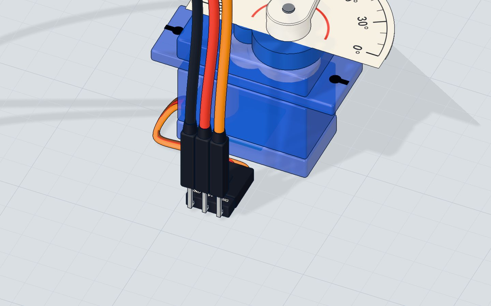
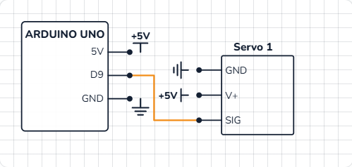

# Sweep a servo

## What you will build

A servo whose arm (the **horn**) sweeps slowly from 0° to 180°, then back to 0°, over and over — like a windscreen wiper. The Serial Monitor prints `180` and `0` each time it reaches an end.

Servos are everywhere small things must move to an exact position: the steering of RC cars, the flaps of model planes, robot arms and legs, camera gimbals, automatic pet feeders. Once you can sweep one, you can point one anywhere.

## How it works

### What is inside a servo

An **SG90 micro servo** weighs only 9 g, but it holds four things:

1. a small **DC motor**,
2. a **gearbox** that makes it slower and much stronger,
3. a **potentiometer** on the output shaft, which tells the servo where its arm is now,
4. a tiny **control chip** that compares where the arm *is* with where it *should be*, and turns the motor until they match.

That loop — measure, compare, correct — is why a servo **holds** its angle even when you push on it. More in [how a servo works](/learn/how-a-servo-works/).

### Talking to a servo: pulses

The servo's signal wire listens for a pulse **every 20 ms** (50 times a second). The **length** of each pulse is the angle:

| Pulse length | Angle |
|---|---|
| ≈ 0.5 ms | 0° |
| ≈ 1.5 ms | 90° (the middle) |
| ≈ 2.4 ms | 180° |

You do not have to make these pulses yourself. The **Servo library** does it in the background: you just say `write(90)`.



> **Did you know?** A servo is not the same as `analogWrite()` PWM. `analogWrite()` changes how long the pin is on at about 490–980 Hz; a servo wants one pulse every 20 ms whose length is between half a millisecond and 2.4 ms.

## The wiring

No breadboard needed: the servo's three wires go straight to the UNO.

1. The **orange** (signal) wire to **pin 9**.
2. The **red** (V+) wire to **5V**.
3. The **brown** (GND) wire to **GND**.

| Servo wire | Goes to | What it does |
|---|---|---|
| SIG (orange) | Pin 9 | The angle, as pulses |
| V+ (red) | 5V | Power for the motor and the control chip |
| GND (brown) | GND | Return path |



> **Tip:** A servo needs at least about 4.5 V and can draw a few hundred milliamps when it moves fast. One SG90 on the UNO's 5V pin is fine. For two or more, give them their own 5 V supply and join its GND to the Arduino's GND.

## The code, line by line

```cpp
#include <Servo.h>
Servo arm;

void setup() {
  arm.attach(9);
  Serial.begin(9600);
}

void loop() {
  for (int angle = 0; angle <= 180; angle += 2) {
    arm.write(angle);
    delay(15);
  }
  Serial.println("180");
  for (int angle = 180; angle >= 0; angle -= 2) {
    arm.write(angle);
    delay(15);
  }
  Serial.println("0");
}
```

- **`#include <Servo.h>`** adds the Servo **library** — ready-made code that comes with the Arduino IDE. You do not need to install anything.
- **`Servo arm;`** makes a servo object called `arm`. You could call it anything; with two servos you would make two objects.
- **`arm.attach(9)`** tells the library which pin the signal wire is on. From now on it sends pulses on pin 9 by itself.
- **`for (int angle = 0; angle <= 180; angle += 2)`** counts 0, 2, 4 … 180 — 91 steps.
- **`arm.write(angle)`** sets the angle. The library changes the pulse length; the servo does the rest.
- **`delay(15)`** gives the arm time to move 2°. 91 steps × 15 ms ≈ **1.4 seconds** for each sweep.
- The second `for` loop counts **down** from 180 to 0 with `angle -= 2`, so the arm comes back.

## Common mistakes

- **The servo jitters or the board resets.** The servo draws too much current from USB. Use a separate 5 V supply for it (GND joined), or add a big capacitor (470 µF) across its power.
- **It buzzes at 0° or 180°.** Some servos cannot reach the full range and push against their stop. Use 5°–175° instead.
- **Nothing moves.** The signal wire is not on the pin given in `attach()`, or the servo has no 5 V. Check the colours: orange signal, red 5 V, brown GND.
- **`analogWrite()` on pin 10 stops working.** On the UNO the Servo library takes over the timer for pins 9 and 10, so PWM on them does not work while a servo is attached.

## Try these challenges

1. Make it stop at **45°, 90° and 135°**, one second at each.
2. Sweep **faster** (`delay(5)`) or **slower** (`delay(40)`). Which is smoother?
3. Add a potentiometer on A0 and turn the arm with the knob: `arm.write(map(analogRead(A0), 0, 1023, 0, 180));`.
4. In the 3D lab, change the step from 2 to 10 and watch how jerky the sweep gets; then turn on labels to read the angle.

## Check yourself

::: quiz
? What does arm.write(90) do?
- Spins the motor 90 times
- Turns the servo arm to the middle and holds it there *
- Waits 90 milliseconds
= write() takes an angle from 0 to 180. 90° is the middle.
? Which servo wire is the signal?
- Brown
- Red
- Orange *
= Brown is GND, red is 5 V and orange is the signal from the pin.
? Why is there a delay(15) inside each for loop?
- So the arm has time to move each 2° step *
- Because the Servo library needs it to work
- To save power
= Without a pause the loop would ask for all the angles in a moment, and the arm would just jump to the end.
:::

## Questions people ask

### What is the difference between a servo and a DC motor?
A DC motor spins freely as long as it has power; you control its speed. A servo has a sensor inside and goes to an **angle** you choose, then holds it. Use a servo to point at something, a DC motor to drive wheels. See [the DC motor project](/learn/dc-motor-transistor-arduino/).

### Can a servo turn 360 degrees?
A normal SG90 turns only 0° to 180°. "Continuous rotation" servos turn all the way round, but then `write()` sets the speed and direction instead of an angle.

### How many servos can one Arduino UNO control?
The Servo library can drive up to 12 servos on an UNO, on any pins. The limit in practice is power: give them their own 5 V supply.

### Do I need a resistor or transistor for a servo?
No. The servo has its own driver inside, and the signal wire needs only a tiny current. Just power, ground and a signal pin.

## What's next

A servo knows its angle; a stepper motor counts it. Next, [spin a prize wheel with a stepper motor](/learn/stepper-motor-arduino/) that stops on an exact segment every time.
