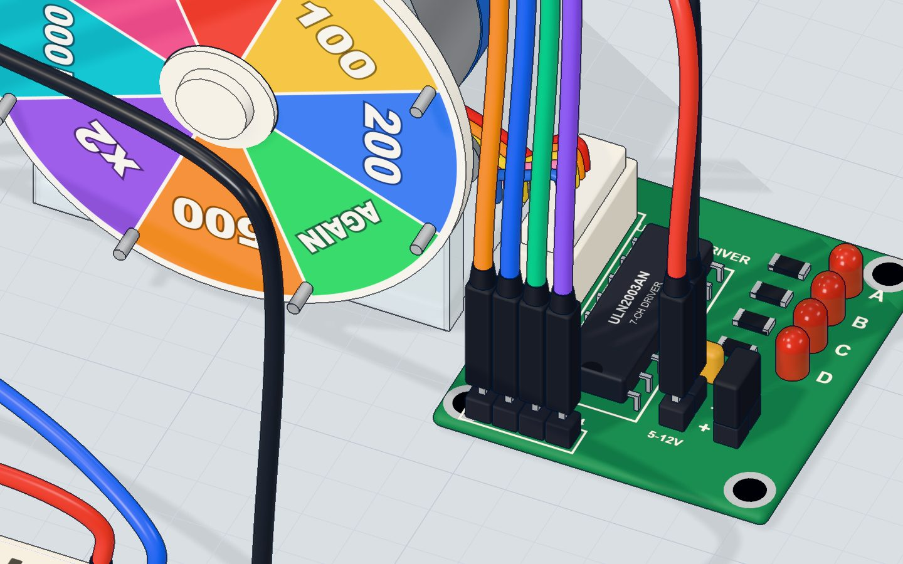
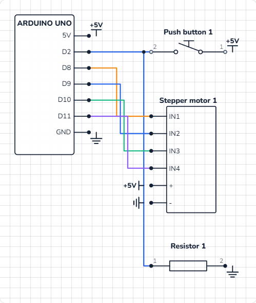

# Spin the wheel

## What you will build

A prize wheel with eight segments — **50, 100, 200, AGAIN, 500, x2, 1000, JACKPOT** — on a stepper motor. Press the button and the Arduino picks a prize at random, spins one whole turn for drama, then carries on to the chosen segment and stops in its middle. The Serial Monitor tells you what you won.

Stepper motors are the reason 3D printers, CNC machines, camera sliders and telescope mounts can move to an exact place without any sensor: they simply count steps.

## How it works

### Steps, not spins

A DC motor spins as long as it has power. A **stepper motor** has several coils around the shaft, and switching them on in order pulls the shaft round **one small step at a time**. Stop switching and it stops — and holds.

This project's **28BYJ-48** makes 32 steps per turn inside, and a 64 : 1 gearbox makes that about **2048 steps for one turn** of the output shaft. So:

| | Steps | Angle |
|---|---|---|
| One step | 1 | ≈ 0.18° |
| One segment of the wheel (2048 ÷ 8) | 256 | 45° |
| A full turn | 2048 | 360° |
| The longest spin (a turn + 7 segments) | 3840 | 675° |

At **12 turns a minute**, the motor makes 2048 × 12 ÷ 60 ≈ 410 steps a second, so a spin lasts between about **5 and 9.4 seconds**.

### Why it needs a driver board

Each coil needs far more current than an Arduino pin can give (a pin is safe to about 20 mA). The little **ULN2003** board is seven transistor switches in one chip — the same idea as the TIP120 in [the DC motor project](/learn/dc-motor-transistor-arduino/), just four times over. The Arduino's pins IN1–IN4 only tell it **which** coil to switch; the four **LEDs A–D** on the board show which coils are on.



### The button: a pull-down resistor

The button joins **5 V** to **pin 2** when pressed. When it is not pressed, a **10 kΩ resistor** to GND holds pin 2 firmly at 0 V (LOW) — that is a **pull-down** resistor. Without it, the pin would "float" and read random values. When pressed, only 5 V ÷ 10 kΩ = **0.5 mA** flows through it. See [pull-up and pull-down resistors](/learn/pull-up-pull-down-resistors/).

## The wiring

**The stepper** (on its driver board, no breadboard):

1. **Pin 8 → IN1**, **pin 9 → IN2**, **pin 10 → IN3**, **pin 11 → IN4**.
2. The board's **+** to **5V**, and **−** to **GND**.

**The button** (on the breadboard):

3. Push the **button** across the middle gap with its legs in **10e, 12e, 10f and 12f**.
4. Put the **10 kΩ resistor** from **12c** to **16c**.
5. A wire from **5V** to **10a**, a wire from **pin 2** to **12a**, and a wire from **16a** to **GND**.

| Part pin | Goes to | What it does |
|---|---|---|
| Driver IN1 · IN2 · IN3 · IN4 | Pins 8 · 9 · 10 · 11 | Choose which coil is on |
| Driver + / − | 5V / GND | Power for the motor coils |
| Button, column 10 | 5V | One side of the switch |
| Button, column 12 | Pin 2 | Reads HIGH while pressed |
| 10 kΩ resistor | Column 12 → GND (16) | Pull-down: LOW when not pressed |



## The code, line by line

```cpp
#include <Stepper.h>
const int TURN = 2048;          // steps in one full turn
const int SEGMENTS = 8;
const int BUTTON = 2;
const char* PRIZES[] = { "50", "100", "200", "AGAIN", "500", "x2", "1000", "JACKPOT" };
Stepper wheel(TURN, 8, 10, 9, 11); // IN1, IN3, IN2, IN4
int at = 0;                     // the segment under the pointer

void setup() {
  pinMode(BUTTON, INPUT);
  wheel.setSpeed(12);           // turns a minute
  randomSeed(analogRead(A0));
  Serial.begin(9600);
  Serial.println("Press the button!");
}

void loop() {
  if (digitalRead(BUTTON) == HIGH) {
    int prize = random(SEGMENTS);
    int ahead = (prize - at + SEGMENTS) % SEGMENTS;
    wheel.step(TURN + ahead * (TURN / SEGMENTS));
    at = prize;
    Serial.print("Landed on ");
    Serial.println(PRIZES[at]);
  }
}
```

- **`#include <Stepper.h>`** adds the Stepper library that comes with the Arduino IDE.
- **`const char* PRIZES[]`** is a list of eight pieces of text. `PRIZES[0]` is `"50"`, `PRIZES[7]` is `"JACKPOT"`.
- **`Stepper wheel(TURN, 8, 10, 9, 11);`** — note the order: **8, 10, 9, 11** is IN1, IN3, IN2, IN4. The library switches its pins in a fixed pattern, and the 28BYJ-48's coils only follow it in this order. With 8, 9, 10, 11 the motor just shakes.
- **`int at = 0;`** remembers which segment is under the pointer.
- **`wheel.setSpeed(12)`** — 12 turns a minute. About 15 is the most this motor can do on 5 V.
- **`randomSeed(analogRead(A0))`** — nothing is wired to A0, so it reads electrical noise. That seeds the random numbers, so you do not get the same prizes every time you reset.
- **`random(SEGMENTS)`** picks a whole number from 0 to 7.
- **`(prize - at + SEGMENTS) % SEGMENTS`** — how many segments forward to the prize. `%` (modulo) is the remainder after dividing, so the count wraps round: from segment 6 to segment 1 is (1 − 6 + 8) % 8 = **3** segments ahead.
- **`wheel.step(TURN + ahead * (TURN / SEGMENTS))`** — one full turn, plus 256 steps per segment. `step()` waits until the move is done.

## Common mistakes

- **The motor hums or shakes but does not turn.** The pin order is wrong. The library needs **8, 10, 9, 11** — and the wires must go 8 → IN1, 9 → IN2, 10 → IN3, 11 → IN4.
- **It spins by itself without a press.** The 10 kΩ pull-down is missing, so pin 2 floats and sometimes reads HIGH.
- **It spins again and again.** You are still holding the button: as soon as a spin ends, the loop sees HIGH again. Let go during the spin.
- **The motor is weak or misses steps.** `setSpeed()` is too high. Keep it at 15 or below for the 28BYJ-48.

## Try these challenges

1. Make it spin **two** full turns before it stops (`2 * TURN`).
2. Print how many segments it travelled, as well as the prize.
3. Ring a buzzer when it lands on **JACKPOT** (compare `at == 7`).
4. In the 3D lab, press the button and watch the **LEDs A–D** on the driver board light in turn. Then change `setSpeed(12)` to `setSpeed(4)` and watch them slowly.

## Check yourself

::: quiz
? How many steps does this stepper need to move one segment of the 8-segment wheel?
- 8
- 256 *
- 2048
= One turn is 2048 steps; 2048 ÷ 8 segments = 256 steps.
? What does the 10 kΩ resistor from pin 2 to GND do?
- It limits the current to the motor
- It holds pin 2 LOW when the button is not pressed *
- It makes the button press harder
= It is a pull-down resistor. Without it pin 2 would float and read random values.
? The pointer is on segment 5 and the prize is segment 2. What is (2 − 5 + 8) % 8?
- 3
- 5 *
- −3
= 2 − 5 + 8 = 5, and 5 % 8 = 5. The wheel moves 5 segments forward (after its full turn).
:::

## Questions people ask

### Why is the pin order 8, 10, 9, 11 for the 28BYJ-48?
The Arduino Stepper library switches its four pins in a pattern made for motors wired in pairs. The 28BYJ-48's coils sit in a different order on the ULN2003 board, so swapping the middle two pins (IN1, IN3, IN2, IN4) lines them up. More in [the 28BYJ-48 and ULN2003 explained](/learn/28byj-48-stepper-motor-uln2003/).

### Is it really 2048 steps per revolution?
Almost. The gearbox is really about 63.7 : 1, not 64 : 1, so a true turn is about 2038 steps. For a wheel the difference is tiny; for a clock you would notice.

### How fast can a 28BYJ-48 turn?
About 15 turns a minute on 5 V. Faster, and it misses steps. It is slow but strong for its size — perfect for wheels, blinds and pointers.

### Can I do other things while the stepper turns?
Not with `step()`: it blocks until the move ends. Libraries like AccelStepper let you move a step at a time inside `loop()`, so the Arduino can read buttons meanwhile.

## What's next

Motors done — now let the Arduino look after something alive. Build [a smart plant monitor with a soil sensor and an OLED screen](/learn/plant-watering-monitor-soil-sensor-oled/).
