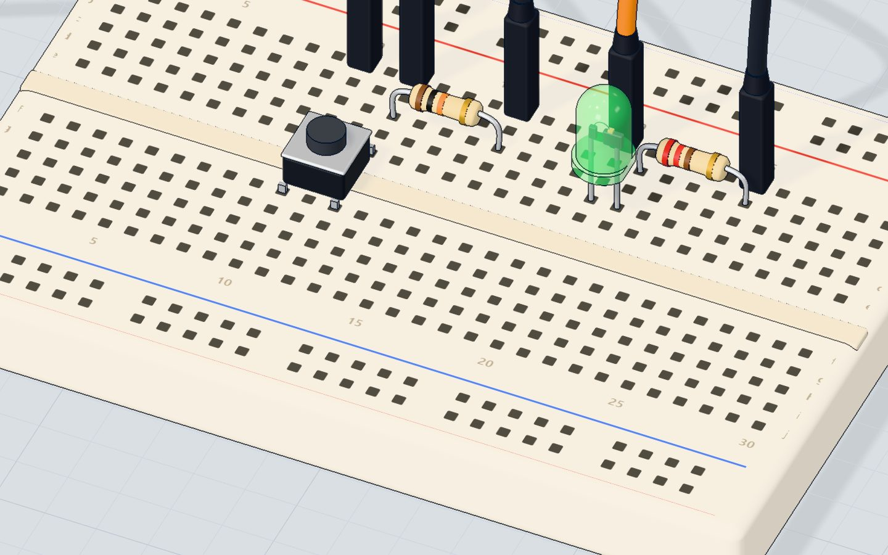

# What is a breadboard?

## The short answer

A breadboard is a plastic board full of holes with **metal strips hidden inside**. When you push two legs into holes that share a strip, they are connected — exactly as if you had soldered a wire between them. Pull them out and the board is ready for the next idea.

The name is old: early radio builders really did nail parts onto wooden boards meant for slicing bread.

## Which holes are joined

<svg viewBox="0 0 640 300" role="img" aria-label="Diagram: rails run along the long edges, five-hole strips run across, and a gap splits the board in two" style="width:100%;height:auto;max-width:640px;display:block;margin:1rem auto;font-family:inherit">
  <rect x="10" y="10" width="620" height="280" rx="14" fill="#F8F4EB" stroke="#D8CFBC"/>
  <line x1="40" y1="34" x2="600" y2="34" stroke="#E2483D" stroke-width="3"/><line x1="40" y1="52" x2="600" y2="52" stroke="#2563EB" stroke-width="3"/>
  <line x1="40" y1="248" x2="600" y2="248" stroke="#E2483D" stroke-width="3"/><line x1="40" y1="266" x2="600" y2="266" stroke="#2563EB" stroke-width="3"/>
  <text x="604" y="38" font-size="14" fill="#E2483D" font-weight="800">+</text><text x="604" y="57" font-size="14" fill="#2563EB" font-weight="800">−</text>
  <rect x="30" y="144" width="580" height="12" rx="4" fill="#EDE4D0"/>
  <text x="320" y="154" font-size="11" text-anchor="middle" fill="#8A7F68">the middle gap — nothing crosses it</text>
  <g fill="#3B3428">
    <circle cx="120" cy="76" r="4"/><circle cx="120" cy="92" r="4"/><circle cx="120" cy="108" r="4"/><circle cx="120" cy="124" r="4"/><circle cx="120" cy="140" r="0"/>
    <circle cx="150" cy="76" r="4"/><circle cx="150" cy="92" r="4"/><circle cx="150" cy="108" r="4"/><circle cx="150" cy="124" r="4"/>
    <circle cx="120" cy="172" r="4"/><circle cx="120" cy="188" r="4"/><circle cx="120" cy="204" r="4"/><circle cx="120" cy="220" r="4"/>
  </g>
  <rect x="112" y="66" width="16" height="66" rx="8" fill="none" stroke="#0E7C86" stroke-width="3"/>
  <rect x="112" y="162" width="16" height="66" rx="8" fill="none" stroke="#0E7C86" stroke-width="3"/>
  <rect x="142" y="66" width="16" height="66" rx="8" fill="none" stroke="#0E7C86" stroke-width="3" stroke-dasharray="4 3"/>
  <text x="180" y="100" font-size="15" fill="#14202E" font-weight="800">5 holes across = one strip</text>
  <text x="180" y="120" font-size="13" fill="#4A5A6E">each column of five (a–e) is joined; f–j is a separate strip</text>
  <text x="180" y="200" font-size="15" fill="#14202E" font-weight="800">The other side: its own strips</text>
  <text x="40" y="26" font-size="13" fill="#4A5A6E">rails: the whole length is joined (for + and −)</text>
</svg>

There are only three rules:

1. **Strips of five.** In the middle area, each line of **five holes** (for example 12a, 12b, 12c, 12d, 12e) is one strip. Anything pushed into those five holes is connected.
2. **The gap.** The channel down the middle splits the board in two: 12a–12e is **not** connected to 12f–12j. Chips and buttons straddle the gap so that each of their legs gets its own strip.
3. **The rails.** The long lines along the edges (red **+** and blue **−**) run the whole length of the board. Connect them once to 5V and GND, and you have power everywhere.

> **Tip:** In our 3D lab, open the Wiring tab and choose **List**: every hole shows which part's leg is in it. It's the fastest way to learn the strips.

## How a real circuit uses it

Look at a knob (potentiometer) project: the knob's three legs each sit in their own strip; a jumper brings 5V to one strip, GND to another, and the middle leg's strip goes to pin A0. The resistor and LED share a strip where one leg meets the other — that shared strip *is* the connection.

::: 3d knob "Turn the knob: the strips carry the voltage from the middle leg to pin A0"

## The 4 mistakes every beginner makes

- **Both legs of a part in the same strip.** The strip connects them, so the part is short-circuited — an LED never lights, a resistor does nothing. Turn the part so its legs are in **different** strips.
- **Forgetting the gap.** Two wires at 12c and 12h are *not* connected.
- **Split rails.** On some long breadboards the rails are broken in the middle (look for a gap in the red/blue line). Bridge them with a short wire.
- **Loose legs.** A leg that isn't pushed in all the way connects only sometimes. Push firmly until it stops.

## Do I even need a breadboard?

No! For modules with header pins (like the HC-SR04 distance sensor, a servo or an OLED screen) you can plug jumper wires straight onto the pins. In our 3D lab every part can also stand on the table with wires going straight to its legs — the breadboard is just a convenient way to join many legs at once.

## Check yourself

::: quiz
? Which holes are connected inside a breadboard?
- Each line of five holes (like 12a to 12e) *
- Every hole in the same row letter (all the a holes)
- None — you need wires for everything
= Each column of five holes on one side of the gap is one metal strip.
? Are 12c and 12h connected?
- No — the middle gap separates them *
- Yes, they are in the same column
- Only when a part is pushed in
= The gap splits every column in two: a–e is one strip, f–j another.
? Why does an LED with both legs in the same strip never light?
- The strip connects its two legs, so it is short-circuited *
- The strip is not connected to anything
- LEDs only work in the rails
= Both legs are joined by the metal strip, so current goes around the LED instead of through it.
:::

## Questions people ask

### What size breadboard should I buy?
A **half-size** board (400 holes, 30 columns) is perfect for every beginner project here. Full-size (830 holes) helps for bigger builds.

### Can a breadboard handle high current?
No — keep it under about 1 A. Motors that need more should be wired with thicker wires and a separate supply.

### Why do some breadboards have numbers and letters?
So you can describe a position exactly — "LED in 12c" — just like squares on a chessboard. Our 3D lab uses the same names.
